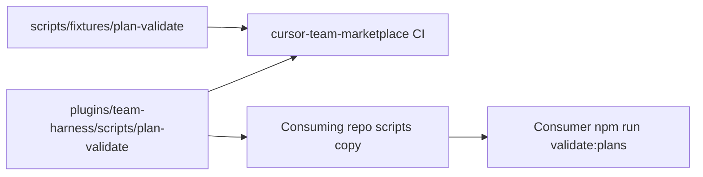

# Deterministic plan validation (team-harness)

## Recommended execution authority

| Slice             | Recommended authority | Agent instruction                                      |
| ----------------- | --------------------- | ------------------------------------------------------ |
| plan-review       | Plan-only PR          | Do not implement. Stop after opening the plan-only PR. |
| plan-validate-lib | Open PR only          | Do not merge. Stop after opening the PR.               |
| fixtures-tests    | Open PR only          | Do not merge. Stop after opening the PR.               |
| ci-npm            | Open PR only          | Do not merge. Stop after opening the PR.               |
| docs-skill        | Open PR only          | Do not merge. Stop after opening the PR.               |
| plan-closure      | Open PR only          | Do not merge. Stop after opening the PR.               |

Repo default: **Open PR only** (see team skill `/planning-methodology`).

## Repository topology (default)

Multi-slice plans stack execution order, not Git branches. Integration branch is `main`.

**Before implementation:** start from latest `origin/main`.

**Before opening the PR:** branch represents only this slice — prior-slice work is on the integration branch, not via branch ancestry.

**After opening the PR:** GitHub PR base is `main`; diff excludes prior-slice work except through merged `main`.

This plan is **same-repo / single-checkout**: `multipliers-dev/cursor-team-marketplace` only. Do not edit consuming repositories in this plan.

---

## Context from reconnaissance

| Area | Current state |
| --- | --- |
| Methodology | Canonical procedure in [`plugins/team-harness/skills/planning-methodology/SKILL.md`](../../plugins/team-harness/skills/planning-methodology/SKILL.md), skeleton in [`_template.plan.md`](../../plugins/team-harness/skills/planning-methodology/_template.plan.md) |
| Consuming repos | Copy prose into repo `planning-standards.md` and `_template.plan.md`; **no** automated sync today |
| Vendoring precedent | Copy-only snapshots from [`plugins/team-harness/scripts/`](../../plugins/team-harness/scripts/) (hooks) |
| Marketplace CI | [`scripts/check.sh`](../../scripts/check.sh) + Vitest on `scripts/**/*.test.ts` |
| Prior art | Resumes `validate:lifecycle` pattern; **no** plan validator exists |



**Motivation:** recurring planning-conformance defects in consuming repos (authority, acceptance/verification, todo/prompt mismatch, topology, structural contradictions). Catch structural violations deterministically; keep semantic merge-safety review (Bugbot, humans).

---

## Slice — plan-review

**Recommended authority:** Plan-only PR

**Rationale:**

- Plan must land for review before validator implementation
- Expected diff is plan artifact only

**Agent instruction:** Do not implement. Stop after opening the plan-only PR.

**Goal:** Commit this plan artifact only.

**Acceptance:** Plan file at `.cursor/plans/2026-10-23-plan-validator.plan.md` with frontmatter todos, authority table, topology, per-slice blocks, agent prompts, and `plan-closure` todo.

---

## Slice — plan-validate-lib

**Recommended authority:** Open PR only

**Rationale:**

- Core library + CLI are one merge-safe unit before tests and CI wire-up
- No consumer-repo changes

**Agent instruction:** Do not merge. Stop after opening the PR.

**Goal:** Implement the canonical validator under team-harness scripts.

**Acceptance:**

- [`plugins/team-harness/scripts/lib/plan-validate.ts`](../../plugins/team-harness/scripts/lib/plan-validate.ts) exports validation with `PlanIssue` (`file`, `line`, `rule`, `message`)
- [`plugins/team-harness/scripts/validate-plans.ts`](../../plugins/team-harness/scripts/validate-plans.ts) CLI: discovery, explicit paths, `--profile template`, optional `.cursor/plan-validator.json`
- Frontmatter via `yaml`; body via line-scanned markdown (no AST framework)
- Actionable-todo prompt rule: `pending` / `in_progress` require `### <todo-id>`; completed/cancelled optional; orphan/duplicate headings rejected
- Machine rules per plan sections below (authority, topology labels, slice blocks, closure)

**Prerequisite:** `plan-review` merged.

---

## Slice — fixtures-tests

**Recommended authority:** Open PR only

**Rationale:**

- Regression coverage before CI gates depend on validator
- Fixtures stay in marketplace `scripts/` (not plugin-only) for Vitest

**Agent instruction:** Do not merge. Stop after opening the PR.

**Goal:** Automated coverage for valid/invalid plans and diagnostic line numbers.

**Acceptance:**

- [`scripts/fixtures/plan-validate/`](../../scripts/fixtures/plan-validate/) valid single/multi-slice and targeted `invalid-*` fixtures
- [`scripts/plan-validate.test.ts`](../../scripts/plan-validate.test.ts) asserts rules and line numbers
- Default discovery excludes `archive/**` and `_template.plan.md`

**Prerequisite:** `plan-validate-lib` merged.

---

## Slice — ci-npm

**Recommended authority:** Open PR only

**Rationale:**

- Wires validator into repo scripts and CI without doc/skill churn in same PR

**Agent instruction:** Do not merge. Stop after opening the PR.

**Goal:** Marketplace can run template validation and tests in CI.

**Acceptance:**

- Root `package.json`: `validate:plans`, `validate:plans:template`; add `yaml` devDependency
- [`.github/workflows/ci.yml`](../../.github/workflows/ci.yml) runs template validation after tests; optional `check.sh` hook
- Bump plugin + marketplace version per [`versioning.md`](../../plugins/team-harness/docs/versioning.md) (`1.11.0` → `1.12.0`)

**Prerequisite:** `fixtures-tests` merged.

---

## Slice — docs-skill

**Recommended authority:** Open PR only

**Rationale:**

- Distribution and authoring guidance ship after validator exists and CI proves it

**Agent instruction:** Do not merge. Stop after opening the PR.

**Goal:** Document vendoring and extend planning-methodology skill.

**Acceptance:**

- New [`plugins/team-harness/docs/plan-validation.md`](../../plugins/team-harness/docs/plan-validation.md) (install, run, update, CI without plugin)
- [`planning-methodology/SKILL.md`](../../plugins/team-harness/skills/planning-methodology/SKILL.md): Plan validation subsection
- [`team-harness/README.md`](../../plugins/team-harness/README.md) scripts table updated

**Prerequisite:** `ci-npm` merged.

---

## Machine-enforced rules (validator contract)

### Shared methodology

**Frontmatter:** `name`, `overview`, `todos`, `isProject`; unique todo `id`s; allowed statuses; last todo `plan-closure` when multi-slice.

**Agent prompts:** section title `## Agent prompts (copy/paste for Cursor)`; labeled `Authority` / `Topology` / `Deliverables` / `Verification` in actionable prompts; optional `Repositories:` when slice lists required repositories.

**Plan-level:** `## Recommended execution authority` table; **Repo default:** line (configurable hint).

**Per-slice body:** `**Recommended authority:**`, `**Rationale:**`, `**Agent instruction:**`, `**Acceptance:**` (exceptions for Plan-only PR, Manual verification gate, plan-closure per skill).

**Authority consistency:** slice, table, and prompt agree on normalized authority label.

**Not enforced:** merge-safety semantics, verification sufficiency, diagram preservation, cross-repo completion correctness.

### Repo-specific (optional `.cursor/plan-validator.json`)

`integrationBranch`, `plansGlobs` / `excludeGlobs`, `requireRepoDefaultLine`, `repoDefaultHint` — no hardcoded consumer commands.

---

## Compatibility and migration

- In-flight consumer plans may omit prompts for **completed** todos; actionable todos still validated.
- Archived marketplace plans excluded from default CI (`--include-archive` for audits).
- Consumer rollout: copy scripts + optional config in **later** PRs (out of scope here).

---

## Plan closure (docs-only PR)

**Recommended authority:** Open PR only

**Rationale:**

- Docs-only archival; human review of closure checklist

**Agent instruction:** Do not merge. Stop after opening the PR.

After `docs-skill` merges:

1. Verify implementation PRs are actually merged to `main` (not merely frontmatter `completed`)
2. Verify remaining todos are `completed` or `cancelled`
3. Add `# Shipped` with date, PR links, deferred work
4. Move to `.cursor/plans/archive/2026-10-23-plan-validator.plan.md`
5. Mark `plan-closure` completed; update agent prompt references to the archived path
6. No production behavior changes

---

## Agent prompts (copy/paste for Cursor)

Use a **fresh Agent-mode chat** per slice. Headings use frontmatter `id` values exactly.

### plan-review

```text
@.cursor/plans/2026-10-23-plan-validator.plan.md

Execute only plan-review. Do not start plan-validate-lib or later slices.

Authority: Plan-only PR — commit the plan artifact only; do not implement. Stop after opening the plan-only PR.

Topology: start from latest origin/main; branch represents only the plan artifact; PR base must be main.

Deliverables: commit .cursor/plans/2026-10-23-plan-validator.plan.md; mark plan-review completed in plan frontmatter in this PR.

Verification: plan satisfies planning-methodology envelope (frontmatter, authority table, topology, per-slice blocks, agent prompts, plan-closure); mermaid distribution diagram preserved; no validator implementation in this PR.
```

### plan-validate-lib

```text
@.cursor/plans/2026-10-23-plan-validator.plan.md

Implement slice plan-validate-lib only. Prerequisite: plan-review merged. Do not start fixtures-tests or later. Do not archive the plan.

Authority: Open PR only — implement and open the PR; do not merge.

Topology: start from latest origin/main; branch represents only this slice; PR base must be main.

Deliverables: plugins/team-harness/scripts/lib/plan-validate.ts and validate-plans.ts per slice acceptance. Mark plan-validate-lib completed in plan frontmatter in this PR.

Verification: npm run typecheck; manual run validate-plans CLI on a minimal fixture once added locally or smoke path documented in PR.
```

### fixtures-tests

```text
@.cursor/plans/2026-10-23-plan-validator.plan.md

Implement slice fixtures-tests only. Prerequisite: plan-validate-lib merged. Do not start ci-npm or later. Do not archive the plan.

Authority: Open PR only — implement and open the PR; do not merge.

Topology: start from latest origin/main; branch represents only this slice; PR base must be main.

Deliverables: scripts/fixtures/plan-validate/* and scripts/plan-validate.test.ts per slice acceptance. Mark fixtures-tests completed in plan frontmatter in this PR.

Verification: npm test.
```

### ci-npm

```text
@.cursor/plans/2026-10-23-plan-validator.plan.md

Implement slice ci-npm only. Prerequisite: fixtures-tests merged. Do not start docs-skill or plan-closure. Do not archive the plan.

Authority: Open PR only — implement and open the PR; do not merge.

Topology: start from latest origin/main; branch represents only this slice; PR base must be main.

Deliverables: package.json scripts, yaml dep, ci.yml and optional check.sh template validation; plugin/marketplace version bump from main. Mark ci-npm completed in plan frontmatter in this PR.

Verification: npm ci; npm run typecheck; npm test; npm run validate:plans:template (once script exists).
```

### docs-skill

```text
@.cursor/plans/2026-10-23-plan-validator.plan.md

Implement slice docs-skill only. Prerequisite: ci-npm merged. Do not start plan-closure. Do not archive the plan.

Authority: Open PR only — implement and open the PR; do not merge.

Topology: start from latest origin/main; branch represents only this slice; PR base must be main.

Deliverables: plan-validation.md, planning-methodology SKILL.md subsection, team-harness README scripts table. Mark docs-skill completed in plan frontmatter in this PR.

Verification: sh scripts/check.sh; npm test.
```

### plan-closure

```text
@.cursor/plans/2026-10-23-plan-validator.plan.md

Execute only plan-closure.

Authority: Open PR only — docs-only archive PR; do not merge.

Prerequisites: plan-validate-lib through docs-skill actually merged to main (not merely frontmatter completed).

Topology: start from latest origin/main; branch represents only this slice; PR base must be main.

Deliverables: verify slice todos, add # Shipped note, move plan to .cursor/plans/archive/2026-10-23-plan-validator.plan.md, mark plan-closure completed, update agent prompt references to the archived path.

Verification: confirm all prerequisite implementation PRs are merged and slice todos are completed before archiving.
```
