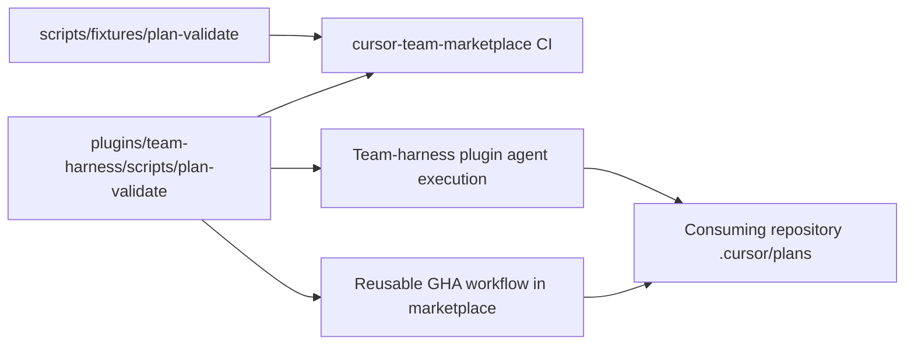

# Deterministic plan validation (team-harness)

## Recommended execution authority

| Slice                    | Recommended authority | Agent instruction                                      |
| ------------------------ | --------------------- | ------------------------------------------------------ |
| plan-review              | Plan-only PR          | Do not implement. Stop after opening the plan-only PR. |
| plan-validate-lib        | Open PR only          | Do not merge. Stop after opening the PR.               |
| fixtures-tests           | Open PR only          | Do not merge. Stop after opening the PR.               |
| ci-npm                   | Open PR only          | Do not merge. Stop after opening the PR.               |
| centralized-consumption  | Open PR only          | Do not merge. Stop after opening the PR.               |
| consumer-adoption        | Open PR only          | Do not merge. Stop after opening the PR.               |
| docs-skill               | Open PR only          | Do not merge. Stop after opening the PR.               |
| plan-closure             | Open PR only          | Do not merge. Stop after opening the PR.               |

Repo default: **Open PR only** (see team skill `/planning-methodology`).

## Repository topology (default)

Multi-slice plans stack execution order, not Git branches. Integration branch is `main`.

**Before implementation:** start from latest `origin/main`.

**Before opening the PR:** branch represents only this slice — prior-slice work is on the integration branch, not via branch ancestry.

**After opening the PR:** GitHub PR base is `main`; diff excludes prior-slice work except through merged `main`.

The authoritative plan file lives in **`multipliers-dev/cursor-team-marketplace`**. Slices through `ci-npm` are same-repo. **`centralized-consumption`** requires one consumer repository **selected and explicitly authorized by Michael** for **smoke verification only** (see that slice); marketplace implementation and consumer smoke may run in **separate** Cloud Agent sessions. **`consumer-adoption`** rolls out workflow configuration across applicable repositories via **separate per-repo PRs** plus a **plan-status PR** in this repo. Do not assume GitHub App access means required repositories are checked out—Cloud Agents launched against one repository receive credentials for that repository only; each consumer repo needs its own launch, preflight, and checkout identity proof before edits.

### Repository inventory

| Role | Repository |
| --- | --- |
| **Canonical source** | `multipliers-dev/cursor-team-marketplace` |
| **Candidate consumers** (inspect in **`consumer-adoption`**; smoke target in **`centralized-consumption`**) | See list below |

**Candidate consumers:**

- `mastermichaelt/resumes` — proposed smoke-test consumer for **`centralized-consumption`** (subject to Michael’s explicit authorization, access, and checkout preflight)
- `mastermichaelt/portfolio`
- `mastermichaelt/mastermichaelt`
- `multipliers-dev/editorial-workflow`
- `multipliers-dev/renovate-workflow`
- `multipliers-dev/codenames-ai-guesser`
- `multipliers-dev/savepoints`

Both GitHub accounts (`mastermichaelt`, `multipliers-dev`) may be reachable via the connected GitHub integration, but **GitHub API / App access alone is not proof of a local checkout**. Each repository still requires its own checkout and identity preflight (`pwd`, `git remote get-url origin`) in the environment that executes work for that repo.

---

## Context from reconnaissance

| Area | Current state |
| --- | --- |
| Methodology | Canonical procedure in [`plugins/team-harness/skills/planning-methodology/SKILL.md`](../../plugins/team-harness/skills/planning-methodology/SKILL.md), skeleton in [`_template.plan.md`](../../plugins/team-harness/skills/planning-methodology/_template.plan.md) |
| Consuming repos | Install team-harness plugin for agent-side validation; optional reusable workflow reference for CI—**no** validator source copy |
| Marketplace CI | [`scripts/check.sh`](../../scripts/check.sh) + Vitest; `validate:plans` / `validate:plans:template` on `main` |
| Prior art | Resumes `validate:lifecycle` pattern; plan validator shipped in `plan-validate-lib` through `ci-npm` |



**Motivation:** recurring planning-conformance defects in consuming repos (authority, acceptance/verification, todo/prompt mismatch, topology, structural contradictions). Catch structural violations deterministically; keep semantic merge-safety review (Bugbot, humans).

---

## Architectural decisions

### 2026-10-23 — Centralized consumption (no copy vendoring)

Copy-only vendoring of validator TypeScript is **no longer desired**. The validator and planning methodology stay centrally maintained in `cursor-team-marketplace`. Consumers must not copy validator source, maintain independent validator implementations, or depend on an npm package.

Two consumption paths, both using the **same canonical validator implementation** in this repository:

1. **Cursor plugin execution:** agents use the installed team-harness plugin to validate the **active** repository’s plans directly, without copying validator files into the consumer.
2. **Centralized CI:** an optional reusable GitHub Actions workflow hosted in `cursor-team-marketplace`, invoked by consumers through a **version-pinned** workflow reference.

Installing the Cursor plugin does **not** automatically configure consumer CI. Consumer-specific workflow references and permissions are rolled out in **`consumer-adoption`** and documented in **`docs-skill`** after verified rollout.

---

## Slice — plan-review

**Recommended authority:** Plan-only PR

**Rationale:**

- Plan must land for review before validator implementation
- Expected diff is plan artifact only

**Agent instruction:** Do not implement. Stop after opening the plan-only PR.

**Goal:** Commit this plan artifact only.

**Acceptance:** Plan file at `.cursor/plans/2026-10-23-plan-validator.plan.md` with frontmatter todos, authority table, topology, per-slice blocks, agent prompts, and `plan-closure` todo.

---

## Slice — plan-validate-lib

**Recommended authority:** Open PR only

**Rationale:**

- Core library + CLI must typecheck and run on a clean checkout after `npm ci` — **`yaml` lands in this slice**, not `ci-npm`
- Merge-safe: minimal Vitest unit tests co-located with the library (not deferred to `fixtures-tests`)
- No consumer-repo changes

**Agent instruction:** Do not merge. Stop after opening the PR.

**Goal:** Implement the canonical validator under team-harness scripts with parser contract below and first-line regression tests.

**Acceptance:**

- Add the canonical validator library and CLI under [`plugins/team-harness/scripts/`](../../plugins/team-harness/scripts/) ([`lib/plan-validate.ts`](../../plugins/team-harness/scripts/lib/plan-validate.ts), [`validate-plans.ts`](../../plugins/team-harness/scripts/validate-plans.ts)): `PlanIssue` (`file`, `line`, `rule`, `message`); discovery, explicit paths, `--profile template`, optional `.cursor/plan-validator.json`
- Extend [`scripts/tsconfig.json`](../../scripts/tsconfig.json) (or add a dedicated TypeScript configuration referenced from root `typecheck`) so **`npm run typecheck` covers both existing root `scripts/` and `plugins/team-harness/scripts/**/*.ts`**
- Add the **`yaml`** devDependency and update **`package-lock.json`** in this slice
- Include **minimal automated tests** for core parsing and validation (e.g. valid plan pass, malformed frontmatter, actionable-todo prompt gap) so this PR is **independently merge-safe** — extend [`vitest.config.ts`](../../vitest.config.ts) `include` if tests live under the plugin tree
- Implement **Parser and CLI behavior** (section below); machine rules per **Machine-enforced rules**
- Co-locate at least one **valid** and one **invalid** plan fixture for CLI smoke (may live under `plugins/team-harness/scripts/fixtures/` or `scripts/fixtures/plan-validate/`; `fixtures-tests` may relocate or expand them)

**Verification:**

- `npm ci`
- `npm run typecheck` — must typecheck `plugins/team-harness/scripts/**/*.ts`
- `npm test` — must exercise the new validator, not only pre-existing tests
- CLI smoke: `tsx plugins/team-harness/scripts/validate-plans.ts` against valid and invalid fixtures — expect exit `0` vs non-zero and actionable diagnostics on stderr/stdout

**Prerequisite:** `plan-review` merged.

---

## Slice — fixtures-tests

**Recommended authority:** Open PR only

**Rationale:**

- **Expands** regression coverage and fixture corpus; does not carry merge-safety alone for `plan-validate-lib`
- Fixtures stay in marketplace `scripts/` (not plugin-only) for Vitest integration tests

**Agent instruction:** Do not merge. Stop after opening the PR.

**Goal:** Expanded positive, negative, and boundary coverage beyond `plan-validate-lib` minimal tests — discovery exclusions, profiles, and line-number regressions.

**Acceptance:**

- [`scripts/fixtures/plan-validate/`](../../scripts/fixtures/plan-validate/) corpus: valid single/multi-slice plans and targeted `invalid-*` fixtures (expand or supersede smoke fixtures from `plan-validate-lib` if relocated)
- [`scripts/plan-validate.test.ts`](../../scripts/plan-validate.test.ts) (or equivalent) asserts rules, profiles, and line numbers across the full fixture set
- Default discovery excludes `archive/**` and `_template.plan.md`

**Prerequisite:** `plan-validate-lib` merged.

---

## Slice — ci-npm

**Recommended authority:** Open PR only

**Rationale:**

- Wires validator into npm scripts and CI **after** deps and core tests exist on `main`
- No new dependencies in this slice (`yaml` already on `main`)

**Agent instruction:** Do not merge. Stop after opening the PR.

**Goal:** Marketplace CI runs plan validation gates.

**Acceptance:**

- Root `package.json`: register `validate:plans` and `validate:plans:template` only (no dependency changes unless a script path fix requires none)
- [`.github/workflows/ci.yml`](../../.github/workflows/ci.yml) runs template validation after tests; optional `check.sh` hook
- Bump plugin + marketplace version per [`versioning.md`](../../plugins/team-harness/docs/versioning.md) (`1.11.0` → `1.12.0`)

**Prerequisite:** `fixtures-tests` merged.

---

## Slice — centralized-consumption

**Recommended authority:** Open PR only

**Rationale:**

- Validator on `main` is proven in marketplace CI; consumers need **centralized** execution paths without copying source
- Plugin and reusable-workflow surfaces must be implemented and smoke-tested before **`consumer-adoption`** rollout and **`docs-skill`**
- Marketplace implementation is a **single merge-safe PR** in this repo; **production rollout** across consumers belongs to **`consumer-adoption`**, not this slice

**Agent instruction:** Do not merge. Stop after opening the PR.

**Goal:** Establish and verify centralized validator execution without distributing source-code copies.

**Topology:**

- **Implementation PR** in `multipliers-dev/cursor-team-marketplace`: reusable workflow, plugin-side invocation path, and marketplace-local verification.
- **Required smoke verification** in **one consumer repository** explicitly authorized by Michael before the slice starts (see Prerequisites)—**smoke only**, not multi-repo rollout (`consumer-adoption`).
- Marketplace implementation and consumer smoke verification **may use separate sessions or Cloud Agent launches**; do **not** assume one environment holds checkouts and credentials for both repositories.

**Required repositories:**

- `multipliers-dev/cursor-team-marketplace` — canonical validator + reusable workflow host, read/write (implementation PR).
- **`mastermichaelt/resumes`** — **proposed** smoke-test consumer (see Prerequisites); **required** for smoke verification of plugin invocation and reusable workflow call once Michael explicitly authorizes this repo for the slice. Read/write in the session that runs smoke. Hard-stop if checkout is missing, identity-mismatched, or not `mastermichaelt/resumes`. If access or checkout cannot be verified, **stop and escalate to Michael**—do **not** substitute another repository for smoke.

**Acceptance:**

- Investigate and document how Cursor exposes installed plugin files to agents and whether bundled TypeScript scripts can reliably execute against the active repository.
- Implement and smoke-test plugin-side invocation from a consuming repository.
- If direct plugin execution is unsupported or unreliable, document the limitation and propose the smallest viable centralized alternative. Do not silently fall back to copying source files.
- Add a reusable GitHub Actions workflow to the marketplace that checks out the canonical validator at a pinned version and validates plans in the calling repository.
- Ensure validation runs against the consumer repository, not accidentally against `cursor-team-marketplace`.
- Preserve strict template validation and the existing `--allow-empty` behavior for repositories without active plans.
- Document permissions, runtime dependencies, version pinning, updates and failure behavior (in-repo docs under team-harness; per-repo rollout matrix and exceptions recorded in **`consumer-adoption`**).
- Verify the reusable workflow in the **authorized consumer repository** (**smoke only**—applicable-repo rollout is **`consumer-adoption`**).
- No npm publishing and no duplicated validator source.

**Verification:**

- Marketplace PR: `npm ci`; `npm run typecheck`; `npm test`; `npm run validate:plans`; `sh scripts/check.sh`
- Consumer smoke environment (`mastermichaelt/resumes`): prove checkout identity in the **same command** as smoke work (`pwd`, `git remote get-url origin`); hard-stop on mismatch or missing checkout—escalate to Michael, do not substitute another repo
- Documented plugin invocation smoke result from `mastermichaelt/resumes` (pass/fail/limitation recorded in PR or linked doc)
- Reusable workflow smoke: workflow run on `mastermichaelt/resumes` validates that repo’s plans (link run URL in PR description)
- Confirm validator checkout pin and working-directory defaults cannot validate marketplace paths when invoked from a consumer

**Prerequisites:**

- `ci-npm` merged.
- **Before implementation starts:** Michael explicitly authorizes **`mastermichaelt/resumes`** as the smoke-test consumer (record in the marketplace PR). Verify the smoke execution environment has required repository access and a **real checkout** of `mastermichaelt/resumes` before smoke work; if not, stop and escalate—do not pick a different repo.

---

## Slice — consumer-adoption

**Recommended authority:** Open PR only

**Rationale:**

- Centralized plugin and reusable workflow must exist on `main` before configuring consumers
- Each consumer repository is an independent merge-safe PR; completion is recorded via **plan-status PR** in this repo (cross-repo slice)
- GitHub App access to a repository does **not** prove it is checked out in the active Cloud Agent environment

**Agent instruction:** Do not merge. Stop after opening the PR(s). Do not merge consumer PRs automatically.

**Goal:** Roll out the centrally maintained plan validator to all applicable repositories that consume team-harness / planning-methodology, without vendoring validator source code.

**Topology:**

- **Per-consumer implementation PR(s)** in each applicable repository (workflow reference, permissions, any repo-specific config)—one PR per repo, independently merge-safe, **Open PR only**.
- **Plan-status PR** in `multipliers-dev/cursor-team-marketplace` after consumer PR(s) satisfy the slice completion condition: mark `consumer-adoption` completed and record adoption matrix (PR links, pins, exceptions)—do **not** edit the plan from consumer repos.

**Deliverables:**

- **Adoption matrix** covering all **seven candidate consumers** from [Repository inventory](#repository-inventory): per-repo decision (**adopt** / **defer** / **exclude**) with rationale, planning/CI findings, pins, and PR links once known (in plan-status PR and/or team-harness docs stub consumed by `docs-skill`)
- Open per-repo configuration PRs for each repository marked **adopt** (one PR per repo)
- Plan-status PR in `cursor-team-marketplace` linking merged consumer PRs, pinned validator versions, deferrals, and exclusions

**Required repositories:**

- `multipliers-dev/cursor-team-marketplace` — plan owner, reusable workflow host, plan-status PR target, read/write.
- **Each of the seven candidate consumer repositories** listed under Repository inventory — inspect with read-only preflight when not editing; read/write only when opening that repo’s adoption PR and only when that repo is a **real checkout** in the agent environment with identity proved via preflight (not App/API access alone). Launch one Cloud Agent (or session) per consumer repo as needed.

**Acceptance:**

1. Inspect **all seven candidate consumers** from the Repository inventory to determine which actually use planning methodology / team-harness, their active-plan conventions (plan paths, `archive/`, template usage), GitHub Actions configuration, and whether centralized validation is appropriate.
2. Produce an adoption matrix with a **decision and rationale per repository** (**adopt** / **defer** / **exclude**), plus pins and PR links once known. Do **not** automatically exclude a repository because it has no current active plans—the validator supports `--allow-empty` for that case.
3. Confirm that centralized plugin execution and the reusable GitHub Actions workflow were implemented and verified in **`centralized-consumption`** before beginning adoption.
4. Configure each **adopt** repository to invoke the centralized reusable workflow using an immutable commit SHA or appropriately protected version tag.
5. Preserve existing repository-specific CI checks, permissions and branch protection.
6. Do not copy validator TypeScript files, publish an npm package, or duplicate the planning methodology.
7. Test each **adopt** repository independently, covering valid plans, invalid plans, and repositories without active plans (`--allow-empty`).
8. Open a **separate implementation PR for each adopt repository**. Do not merge automatically.
9. Record adoption status, PR links, pinned validator versions, deferrals, and deliberate exclusions in the matrix.
10. After consumer PRs merge, record completion through a plan-status PR in `cursor-team-marketplace`.

**Verification:**

- Preflight: for each candidate inspected or edited, prove checkout exists, `pwd` and `git remote get-url origin` match expected owner/name, and minimum capability for declared role before edits
- Per consumer PR: CI runs reusable workflow against **that** repo’s checkout; evidence for valid-plan pass, invalid-plan fail, and `--allow-empty` / no-active-plans behavior where applicable
- Plan-status PR: frontmatter marks `consumer-adoption` completed; matrix lists **all seven** candidates with decision, rationale, pins, and PR links (or documented defer/exclude)

**Prerequisite:** `centralized-consumption` merged.

---

## Slice — docs-skill

**Recommended authority:** Open PR only

**Rationale:**

- **Verified real-world adoption** (`consumer-adoption`) must precede installation and adoption documentation
- **Normative skill text must match validator** (actionable vs completed/cancelled prompt headings)
- Open [PR 61](https://github.com/multipliers-dev/cursor-team-marketplace/pull/61) (`cursor/docs-skill-1253`) holds independently valid docs/methodology work; **keep and rebase/update** it after `consumer-adoption` completes—do not discard—then extend with adoption guidance grounded in the adoption matrix and both consumption paths

**Agent instruction:** Do not merge. Stop after opening the PR.

**Goal:** Document centralized adoption (plugin + reusable CI) and align planning-methodology with the enforced contract.

**Acceptance:**

- New [`plugins/team-harness/docs/plan-validation.md`](../../plugins/team-harness/docs/plan-validation.md): distinguish (a) plugin availability and agent-side execution, (b) GitHub CI enforcement via reusable workflow reference, (c) consumer-specific configuration; version pinning, permissions, updates, failure behavior; **do not** recommend copy-only vendoring or npm install of the validator
- Extend/reconcile with PR 61 content (`plan-validation.md`, SKILL item 7, Plan validation subsection, `reference.md` / `_template.plan.md`, README scripts row) after rebasing on `main` post-`consumer-adoption`; cite verified rollout examples from the adoption matrix where applicable
- [`planning-methodology/SKILL.md`](../../plugins/team-harness/skills/planning-methodology/SKILL.md):
  - **Revise item 7** (and any duplicate wording in staged authoring): require `### <todo-id>` for **actionable** todos (`pending`, `in_progress`); **completed** and **cancelled** todos may omit prompts; any existing `###` under Agent prompts must reference a known todo id (no orphans/duplicates)
  - Add **Plan validation** subsection (when to run `validate:plans`, deterministic vs semantic review, how consumers invoke validation without copying source)
- Mirror the todo/prompt rule in [`reference.md`](../../plugins/team-harness/skills/planning-methodology/reference.md) and boilerplate note in [`_template.plan.md`](../../plugins/team-harness/skills/planning-methodology/_template.plan.md) if they still say every todo requires a heading
- [`team-harness/README.md`](../../plugins/team-harness/README.md) scripts table updated

**Verification:**

- `sh scripts/check.sh`
- `npm test`
- Read/grep confirms SKILL item 7 matches validator todo/prompt rules and docs describe both consumption paths without implying plugin install configures CI automatically

**Prerequisite:** `consumer-adoption` merged (consumer PRs merged and plan-status PR recorded completion).

---

## Parser and CLI behavior (implement before coding)

These decisions are part of the validator contract; `plan-validate-lib` must implement them.

| Topic | Behavior |
| --- | --- |
| **Fenced code** | Headings and structure inside fenced blocks are **ignored** for agent-prompt and slice-section scans. Only the **outer** markdown document structure counts. Scan ` ```text ` / ` ``` ` blocks in the Agent prompts section for labeled lines. |
| **YAML frontmatter** | Missing `---` delimiters, unclosed frontmatter, or **malformed YAML** → **fail closed** with a parse error issue (line 1 or delimiter line). Empty `todos` or wrong types → schema issues. |
| **Todo `status`** | Only `pending`, `in_progress`, `completed`, `cancelled`. **Unrecognized status → error** (fail closed). |
| **Authority labels** | Normalize slice/table/prompt authorities to the four known labels (+ orthogonal Manual gate). **Unrecognized recommended authority → error** when the slice is actionable. Prompt `Authority:` must prefix-match a known label after normalization. |
| **Multi-file runs** | **Aggregate all diagnostics** across discovered or explicit paths; exit non-zero if any file has issues. Do not stop at first file or first issue within a file (report all issues per file). |
| **`--profile template`** | Same schema and rules; **relaxes placeholder checks only** (allow `….` / `…` in Deliverables, Verification, Acceptance). Does not skip frontmatter, heading correspondence, or authority structure. Used for skill `_template.plan.md` CI. |
| **Default profile** | Strict placeholders: Deliverables / Verification / Acceptance that are only ellipsis placeholders → error for actionable todos. |

---

## Machine-enforced rules (validator contract)

### Shared methodology

**Frontmatter:** `name`, `overview`, `todos`, `isProject`; unique todo `id`s; allowed statuses; last todo `plan-closure` when multi-slice.

**Agent prompts:** section title `## Agent prompts (copy/paste for Cursor)`; labeled `Authority` / `Topology` / `Deliverables` / `Verification` in actionable prompts; optional `Repositories:` when slice lists required repositories.

**Plan-level:** `## Recommended execution authority` table; **Repo default:** line (configurable hint).

**Per-slice body:** `**Recommended authority:**`, `**Rationale:**`, `**Agent instruction:**`, `**Acceptance:**` (exceptions for Plan-only PR, Manual verification gate, plan-closure per skill).

**Authority consistency:** slice, table, and prompt agree on normalized authority label.

**Not enforced:** merge-safety semantics, verification sufficiency, diagram preservation, cross-repo completion correctness.

### Repo-specific (optional `.cursor/plan-validator.json`)

`integrationBranch`, `plansGlobs` / `excludeGlobs`, `requireRepoDefaultLine`, `repoDefaultHint` — no hardcoded consumer commands.

---

## Compatibility and migration

- In-flight consumer plans may omit prompts for **completed** todos; actionable todos still validated.
- Archived marketplace plans excluded from default CI (`--include-archive` for audits).
- **Target consumption model (after centralized-consumption):**
  - **(a) Plugin:** install/configure the team-harness Cursor plugin so agents can run the canonical validator against the **active** repository (no validator source copy)—delivered by **`centralized-consumption`** (plugin path) and verified in smoke before **`consumer-adoption`**.
  - **(b) CI:** add a version-pinned reusable workflow reference in the consumer repo’s GitHub Actions (hosted in the marketplace); validation runs in the **caller’s** checkout—delivered by **`centralized-consumption`** (workflow) and rolled out in **`consumer-adoption`**.
  - **(c) Configuration:** consumer-specific workflow inputs, permissions, and pins remain separate from plugin installation—rolled out in **`consumer-adoption`**, documented in **`docs-skill`** after verified adoption.
- **Not recommended:** copy-only vendoring of `plugins/team-harness/scripts/plan-validate*` into consumer repos, standalone npm packages, or forked validator implementations.
- Applicable-repo rollout is **`consumer-adoption`**; smoke verification in **`centralized-consumption`** is not a substitute for the adoption matrix.

---

## Slice — plan-closure

**Recommended authority:** Open PR only

**Rationale:**

- Docs-only archival; human review of closure checklist
- Must confirm **`centralized-consumption`**, **`consumer-adoption`** (including merged consumer PRs and plan-status PR), and **`docs-skill`** actually merged, with documented exceptions for repos not adopting the validator

**Agent instruction:** Do not merge. Stop after opening the PR.

After `centralized-consumption`, `consumer-adoption`, and `docs-skill` merge:

1. Verify implementation PRs are actually merged to each target repository’s integration branch (`main`) — do not trust frontmatter `completed` alone. Include marketplace PR(s), **each merged consumer adoption PR**, the **consumer-adoption plan-status PR**, and **`docs-skill`**; follow **multi-repo environment preflight** and **checkout identity** when verifying linked repos.
2. Verify the adoption matrix documents any repositories **deliberately excluded** from validator CI (with rationale)
3. Verify remaining todos are `completed` or `cancelled`
4. Verify Manual verification gate verdicts / allowed artifacts when applicable
5. Add `# Shipped` with date, PR links across all repos touched, pinned validator versions, adoption exceptions, deferred work
6. Move to `.cursor/plans/archive/2026-10-23-plan-validator.plan.md`
7. Mark `plan-closure` completed; update agent prompt references to the archived path
8. No production behavior changes

**Prerequisite:** `docs-skill` merged.

---

## Agent prompts (copy/paste for Cursor)

Use a **fresh Agent-mode chat** per slice. Headings use frontmatter `id` values exactly.

### plan-review

```text
@.cursor/plans/2026-10-23-plan-validator.plan.md

Execute only plan-review. Do not start plan-validate-lib or later slices.

Authority: Plan-only PR — commit the plan artifact only; do not implement. Stop after opening the plan-only PR.

Topology: start from latest origin/main; branch represents only the plan artifact; PR base must be main.

Deliverables: commit .cursor/plans/2026-10-23-plan-validator.plan.md; mark plan-review completed in plan frontmatter in this PR.

Verification: plan satisfies planning-methodology envelope (frontmatter, authority table, topology, per-slice blocks, agent prompts, plan-closure); mermaid distribution diagram preserved; no validator implementation in this PR.
```

### plan-validate-lib

```text
@.cursor/plans/2026-10-23-plan-validator.plan.md

Implement slice plan-validate-lib only. Prerequisite: plan-review merged. Do not start fixtures-tests or later. Do not archive the plan.

Authority: Open PR only — implement and open the PR; do not merge.

Topology: start from latest origin/main; branch represents only this slice; PR base must be main.

Deliverables: canonical validator lib + CLI under plugins/team-harness/scripts; extend scripts/tsconfig (or dedicated config) so typecheck covers plugins/team-harness/scripts/**/*.ts; yaml + lockfile; minimal merge-safe validator tests; Parser and CLI behavior table; valid + invalid smoke fixtures for CLI. Mark plan-validate-lib completed in plan frontmatter in this PR.

Verification: npm ci; npm run typecheck (includes plugins/team-harness/scripts/**/*.ts); npm test (new validator tests run, not only existing tests); CLI smoke on valid fixture (exit 0) and invalid fixture (non-zero + diagnostics).
```

### fixtures-tests

```text
@.cursor/plans/2026-10-23-plan-validator.plan.md

Implement slice fixtures-tests only. Prerequisite: plan-validate-lib merged. Do not start ci-npm or later. Do not archive the plan.

Authority: Open PR only — implement and open the PR; do not merge.

Topology: start from latest origin/main; branch represents only this slice; PR base must be main.

Deliverables: scripts/fixtures/plan-validate/* and scripts/plan-validate.test.ts per slice acceptance. Mark fixtures-tests completed in plan frontmatter in this PR.

Verification: npm test.
```

### ci-npm

```text
@.cursor/plans/2026-10-23-plan-validator.plan.md

Implement slice ci-npm only. Prerequisite: fixtures-tests merged. Do not start centralized-consumption, consumer-adoption, docs-skill, or plan-closure. Do not archive the plan.

Authority: Open PR only — implement and open the PR; do not merge.

Topology: start from latest origin/main; branch represents only this slice; PR base must be main.

Deliverables: validate:plans npm scripts only; ci.yml and optional check.sh template validation; plugin/marketplace version bump from main (no new dependencies). Mark ci-npm completed in plan frontmatter in this PR.

Verification: npm ci; npm run typecheck; npm test; npm run validate:plans:template.
```

### centralized-consumption

```text
@.cursor/plans/2026-10-23-plan-validator.plan.md

Implement slice centralized-consumption only. Prerequisites: ci-npm merged; Michael explicitly authorizes mastermichaelt/resumes as smoke-test consumer before you start. Do not start consumer-adoption, docs-skill, or plan-closure. Do not archive the plan.

Authority: Open PR only — implement and open the PR; do not merge.

Topology: marketplace implementation PR on latest origin/main (branch = this slice only; PR base main). Required smoke on mastermichaelt/resumes—not full rollout (consumer-adoption). Implementation and consumer smoke may use separate Cloud Agent launches; do not assume both repos are available in one environment.

Repositories: multipliers-dev/cursor-team-marketplace (implementation, read/write); mastermichaelt/resumes (required smoke, read/write in the smoke session once Michael authorized)—verify access and real checkout with pwd and git remote get-url origin in the same command as smoke work; hard-stop and escalate to Michael if missing or identity-mismatched—do not substitute another repo. Do not assume App/API access equals checkout.

Deliverables: document plugin file exposure and plugin-side invocation (or documented limitation + smallest centralized alternative without copy vendoring); reusable GHA workflow with pinned validator checkout validating caller repo plans (--allow-empty preserved); permissions/runtime/pinning/failure notes; smoke evidence from mastermichaelt/resumes. Mark centralized-consumption completed in plan frontmatter in the marketplace PR. Do not npm-publish, duplicate validator source, or perform multi-repo rollout here.

Verification: npm ci; npm run typecheck; npm test; npm run validate:plans; sh scripts/check.sh; linked consumer smoke for plugin and reusable workflow on mastermichaelt/resumes with checkout identity proved; confirm validation targets consumer checkout not marketplace.
```

### consumer-adoption

```text
@.cursor/plans/2026-10-23-plan-validator.plan.md

Execute slice consumer-adoption only. Prerequisite: centralized-consumption merged. Do not start docs-skill or plan-closure. Do not archive the plan.

Authority: Open PR only — open per-repo PRs and plan-status PR; do not merge automatically.

Topology: one implementation PR per applicable consumer repo (each merge-safe on that repo’s main); separate plan-status PR in cursor-team-marketplace after consumer PRs merge. Do not edit the plan from consumer repos.

Repositories: multipliers-dev/cursor-team-marketplace (plan-status, read/write); all seven candidate consumers from Repository inventory (mastermichaelt/resumes, mastermichaelt/portfolio, mastermichaelt/mastermichaelt, multipliers-dev/editorial-workflow, multipliers-dev/renovate-workflow, multipliers-dev/codenames-ai-guesser, multipliers-dev/savepoints)—preflight each checkout inspected or edited (pwd, git remote get-url origin, role capability); hard-stop if missing or identity-mismatched. GitHub App/API access is not a checkout; Cloud Agents only get credentials for the repo they were launched against—launch per consumer repo.

Deliverables: inspect all seven candidates (methodology use, plan paths/archive/template, GHA config, validation fit); adoption matrix with adopt/defer/exclude decision and rationale per repo (do not exclude solely for no active plans); per-adopt-repo workflow PRs with immutable SHA or protected tag pin; test evidence (valid, invalid, --allow-empty); matrix with PR links and pins; after consumer PRs merge, plan-status PR marking consumer-adoption completed in this repo (do not mark completed from consumer PRs).

Verification: preflight proved for every candidate inspected or edited; each adopt-repo PR CI validates that repo’s plans; plan-status PR matrix covers all seven candidates with decisions and links.
```

### docs-skill

```text
@.cursor/plans/2026-10-23-plan-validator.plan.md

Implement slice docs-skill only. Prerequisite: consumer-adoption merged (consumer PRs merged and plan-status PR recorded). Do not start plan-closure. Do not archive the plan.

Authority: Open PR only — implement and open the PR; do not merge.

Topology: start from latest origin/main; branch represents only this slice; PR base must be main.

Deliverables: rebase/update open PR 61 work (keep, do not discard): plan-validation.md plus SKILL.md item 7 / Plan validation subsection / reference.md / _template.plan.md / README scripts row; extend adoption docs using verified consumer-adoption matrix for plugin execution and reusable workflow CI without copy vendoring or implying plugin install configures CI. Mark docs-skill completed in plan frontmatter in this PR.

Verification: sh scripts/check.sh; npm test; read/grep confirms SKILL item 7 matches validator todo/prompt rules and both consumption paths are documented with real rollout examples where applicable.
```

### plan-closure

```text
@.cursor/plans/2026-10-23-plan-validator.plan.md

Execute only plan-closure.

Authority: Open PR only — docs-only archive PR; do not merge.

Prerequisites: plan-validate-lib through docs-skill actually merged (centralized-consumption, consumer-adoption with merged consumer PRs + plan-status PR, docs-skill)—not merely frontmatter completed. Verify documented exceptions for repos not adopting the validator. Use multi-repo preflight and checkout identity when verifying linked repos.

Topology: start from latest origin/main; branch represents only this slice; PR base must be main.

Deliverables: verify slice todos and linked PRs across repos including adoption matrix; add # Shipped note with pins and exclusions; move plan to .cursor/plans/archive/2026-10-23-plan-validator.plan.md; mark plan-closure completed; update agent prompt references to the archived path.

Verification: confirm all prerequisite implementation PRs are merged, consumer-adoption matrix is complete, and slice todos are completed before archiving.
```
