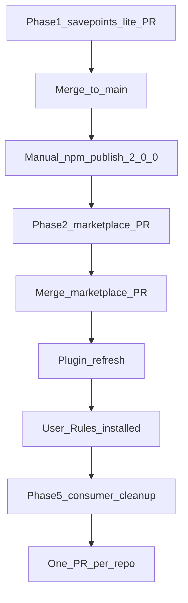

# Centralized Savepoints Lite via Team Marketplace

## Recommended execution authority

| Slice | Recommended authority | Agent instruction |
| --- | --- | --- |
| plan-review | Plan-only PR | Do not implement slices. Stop after opening the plan-only PR. |
| sl-phase1-contract | Open PR only | `multipliers-dev/savepoints-lite` only. Do not edit this marketplace plan file. Do not publish npm. Stop after opening the PR. |
| plan-status-sl-phase1 | Plan-only PR | `cursor-team-marketplace` only — frontmatter/links after savepoints-lite PR merges. Do not implement product code. |
| gate-publish | Manual verification gate | **Prerequisite:** `sl-phase1-contract` merged with full OSS acceptance. Operator publishes `@2.0.0`. No implementation PR. |
| marketplace-distribution | Open PR only | **Prerequisite:** `gate-publish` satisfied. Do not edit plan frontmatter in implementation PR. Stop after opening the PR. |
| plan-status-marketplace | Plan-only PR | Marketplace only — update plan after marketplace implementation PR merges. |
| gate-consumer-prereqs | Manual verification gate | Confirm prerequisites for Phase 5; no consumer edits. Stop with pass/fail report. |
| consumer-cleanup | Open PR only | **Prerequisite:** `gate-consumer-prereqs` passed. Do not edit marketplace plan from consumer repos. One repo per PR. |
| plan-status-consumer-cleanup | Plan-only PR | Marketplace only — update plan after consumer PRs opened. |
| plan-closure | Open PR only | Docs-only archive PR. Do not merge. |

Repo default: **Open PR only** (plan-review for plan artifact only).

## Repository topology

Multi-slice plans stack execution order, not Git branches. Integration branch is `main` for every repository.

**Before implementation:** `git fetch` and branch from latest `origin/main` in the target repo.

**Before opening the PR:** branch contains only the current slice.

**After opening the PR:** GitHub base is `main`; diff excludes prior-slice work except through merged `main`.

**Cross-repo:** Phase 1 → `savepoints-lite`. Phases 2–4 → `cursor-team-marketplace`. Phase 5 → each consumer repo (separate PRs).

## Plan coordination (cross-repository)

This file lives in **`multipliers-dev/cursor-team-marketplace`** and is the **single coordination record** for the initiative. Implementation PRs in other repositories **must not** modify this plan or its frontmatter.

| Event | Where to record progress |
| --- | --- |
| savepoints-lite implementation PR opened/merged | Optional link in PR description only; **plan todo `sl-phase1-contract` → `completed`** in a **separate** `cursor-team-marketplace` plan-status PR (`plan-status-sl-phase1`) after merge |
| Marketplace implementation PR merged | `plan-status-marketplace` plan-only PR |
| Consumer cleanup PRs opened | `plan-status-consumer-cleanup` plan-only PR (inventory + links) |
| Operator publish / manual gates | `gate-publish` / `gate-consumer-prereqs` marked completed in marketplace plan-status PR or operator-noted commit when confirming |

Plan-status PRs are **docs-only** (this plan file ± short `# Progress` notes). Run `npm run validate:plans` on the changed plan path.

## Context and gates



- **Hard gate (marketplace):** Do not open `marketplace-distribution` until `@multipliers-dev/savepoints-lite@2.0.0` exists on npm.
- **Hard gate (consumer cleanup):** Do not start `consumer-cleanup` until publish, marketplace merge, plugin install with readable vendor skills, and User Rules are confirmed.
- **Target semver:** `2.0.0` (breaking: packaged Notion destination removed; explicit-integration tier added).

### Relationship to savepoints-lite PR #13

[PR #13](https://github.com/multipliers-dev/savepoints-lite/pull/13) merged plan-only ([`2026-10-27-oss-readiness-cleanup.plan.md`](https://github.com/multipliers-dev/savepoints-lite/blob/main/.cursor/plans/2026-10-27-oss-readiness-cleanup.plan.md)). Do not reopen PR #13. This plan supersedes that plan’s **pre-2.0.0 seven-consumer `.agents` migration** with **Phase 5 cleanup after marketplace + User Rules**.

**OSS readiness (from PR #13 plan, still required before `gate-publish`):** `sl-phase1-contract` must deliver configuration changes **and** public-package readiness below — not configuration alone. Reference savepoints-lite OSS plan phases 2–4 scope (consolidated into one savepoints-lite PR).

---

## Slice — sl-phase1-contract

**Recommended authority:** Open PR only

**Repositories:** `multipliers-dev/savepoints-lite` (read/write)

**Rationale:** Marketplace distribution requires a publishable `@2.0.0` with explicit-integration config **and** OSS-ready public docs/tests — avoiding a registry release that only partially completes PR #13’s hub work.

**Agent instruction:** savepoints-lite repo only; **do not** edit `cursor-team-marketplace` plan files; do not publish npm or start marketplace work. Stop after opening the PR. Plan frontmatter is updated later via `plan-status-sl-phase1` in the marketplace repo.

**Goal:** Provider-neutral configuration contract for `destination.data_source_id`:

| Precedence | Source |
| --- | --- |
| 1 | Explicit destination from the calling integration (instruction context handoff) |
| 2 | Consumer `.agents/savepoints-notion.yml` (**unchanged:** already overrides packaged defaults) |
| 3 | Packaged `skills/savepoints-notion/defaults.yml` if configured (remove maintainer UUID) |

Router carries explicit destination to Notion provider in **instruction context** (no programmatic API). Provider **adds** tier 1; **preserves** `.agents` > defaults for tiers 2–3. Fail open on missing/invalid destination. Bump `package.json` to `2.0.0`; do not publish.

**Acceptance:**

- **Configuration contract:** explicit integration tier for `destination.data_source_id`; `.agents` > packaged default preserved; fail open on missing/invalid destination; no maintainer `data_source_id` in shipped defaults or generic provider instructions; `templates/consumer/savepoints-notion.yml.example`; external-integration handoff documented (provider-neutral); `"version": "2.0.0"` in `package.json`; **do not** `npm publish`
- **Documentation accuracy (OSS):** README, `docs/adopt.md`, `docs/architecture.md`, `docs/publishing.md`, skills/README reflect `@2.0.0`, explicit-integration precedence, generic external-integration example only
- **Privacy disclosure (OSS):** what is written to Notion, host-owned Notion MCP auth, no credentials or personal destination IDs in the package
- **Reliability limitations (OSS):** best-effort fail-open, no retry queue, instruction-only, bounded async confirmation documented
- **Maintenance and support (OSS):** public npm / GitHub issues; no implied SLA; preserve maintainer `docs/adoption-verification-record.md` history (not in tarball)
- **Release verification (OSS):** `npm test`, `npm run verify`, pack layout vs `expected-package-paths.txt`; split workspace 2.0.0 candidate vs registry dogfood tests if pin lags pre-publish (no gate weakening)
- **Scope guard:** no new CONTRIBUTING/SECURITY/issue-template governance infra
- One savepoints-lite PR opened (Open PR only); **`gate-publish` blocked** until merged with criteria above

---

## Slice — plan-status-sl-phase1

**Recommended authority:** Plan-only PR

**Repositories:** `multipliers-dev/cursor-team-marketplace` (read/write) only

**Rationale:** Coordination record must stay in the marketplace repo; implementation PRs in savepoints-lite cannot update this file.

**Agent instruction:** After savepoints-lite `sl-phase1-contract` PR merges, open a **docs-only** marketplace PR that marks `sl-phase1-contract` `completed` in this plan’s frontmatter and links the merged implementation PR. Do not implement product code.

**Acceptance:** Frontmatter updated; `npm run validate:plans` passes; PR opened (Open PR only).

---

## Slice — gate-publish

**Recommended authority:** Manual verification gate

**Rationale:** Marketplace vendor sync must target a published registry release, not unpublished git source.

**Agent instruction:** Confirm registry version only; no implementation PR. Stop with pass/fail report.

**Acceptance:** `npm view @multipliers-dev/savepoints-lite@2.0.0 version` succeeds; operator records publish.

---

## Slice — marketplace-distribution

**Recommended authority:** Open PR only

**Repositories:** `multipliers-dev/cursor-team-marketplace` (read/write)

**Prerequisite:** `gate-publish` — `@2.0.0` on npm.

**Rationale:** Cursor installs plugin content from Git without `npm install`; canonical skills must be committed under `vendor/` with a thin wrapper and User Rules destination handoff.

**Agent instruction:** Marketplace repo only; do not implement consumer-cleanup. Stop after opening the PR.

**Goal:**

- Committed `plugins/team-harness/vendor/savepoints-lite/` from pinned registry release (`sync` + `verify` scripts, CI).
- Thin `plugins/team-harness/skills/savepoints/SKILL.md` wrapper: reads destination from engineering invariants (User Rules), **carries** it through vendored router → provider instruction context; provider **does not** read User Rules.
- Update [`docs/engineering-invariants.md`](docs/engineering-invariants.md) Savepoints section (personal `data_source_id` only in User Rules, not vendor/canonical package).
- Docs + team-harness version `1.15.0`.
- Root `devDependency` on `@multipliers-dev/savepoints-lite@2.0.0` for build-time sync only.

**Acceptance:** `verify:savepoints-vendor`, `npm test`, `validate:plans`, `scripts/check.sh`; PR opened (Open PR only). **Do not** mark `marketplace-distribution` completed in this plan file — use `plan-status-marketplace` after merge.

---

## Slice — plan-status-marketplace

**Recommended authority:** Plan-only PR

**Repositories:** `multipliers-dev/cursor-team-marketplace` only

**Rationale:** Same cross-repo plan tracking rule as `plan-status-sl-phase1`.

**Agent instruction:** After marketplace implementation PR merges, open docs-only PR: mark `marketplace-distribution` completed, link merged PR. No product code.

**Acceptance:** Frontmatter + link; `npm run validate:plans`; PR opened (Open PR only).

---

## Slice — gate-consumer-prereqs

**Recommended authority:** Manual verification gate

**Rationale:** Consumer cleanup must not run before global integration is live (registry, merged marketplace, installed plugin, User Rules).

**Agent instruction:** Verify prerequisites only; no consumer repo edits. Stop with pass/fail report.

**Acceptance:** Publish, marketplace merge, plugin vendor readable, User Rules updated — all confirmed before `consumer-cleanup`.

---

## Slice — consumer-cleanup

**Recommended authority:** Open PR only

**Prerequisite:** `gate-consumer-prereqs` passed.

**Repositories (inventory):** `multipliers-dev/savepoints-lite`, `multipliers-dev/cursor-team-marketplace`, `multipliers-dev/editorial-workflow`, `multipliers-dev/renovate-workflow`, `multipliers-dev/codenames-ai-guesser`, `mastermichaelt/resumes`, `mastermichaelt/portfolio` — extend if grep finds more.

**Rationale:** Redundant per-repo npm and `AGENTS.md` activation are obsolete once team-harness + User Rules provide global Savepoints.

**Agent instruction:** One repo per PR; do not merge. Stop after opening required PRs.

**Goal:** Remove redundant consumer npm deps, `AGENTS.md` Savepoints activation, obsolete `.agents` Savepoints YAML where appropriate. **Preserve** marketplace build-time `savepoints-lite` devDep; **preserve** savepoints-lite canonical skills/package. Record no-change repos.

**Exclusions:** No hooks, monitoring, or reliability improvements.

**Acceptance:** Per-repo verification; PRs opened (Open PR only). **Do not** update this marketplace plan from consumer repos.

---

## Slice — plan-status-consumer-cleanup

**Recommended authority:** Plan-only PR

**Repositories:** `multipliers-dev/cursor-team-marketplace` only

**Rationale:** Record consumer cleanup inventory and PR links in the coordination plan after cross-repo work completes.

**Agent instruction:** After required consumer PRs are opened (and no-change repos recorded), open docs-only marketplace PR: mark `consumer-cleanup` completed; add short inventory table (repo → PR link or “no change”). No product code.

**Acceptance:** Frontmatter + inventory; `npm run validate:plans`; PR opened (Open PR only).

---

## Slice — plan-closure

**Recommended authority:** Open PR only

**Rationale:** Archive completed multi-slice plan per repository planning standards.

**Agent instruction:** Docs-only PR; do not merge. Stop after opening the PR.

**Acceptance:** Plan moved to `.cursor/plans/archive/` with `# Shipped` note; `plan-closure` todo completed.

---

## Phase 4 — Verification (marketplace slice)

| Acceptance criterion | How |
| --- | --- |
| Wrapper discoverable | `scripts/check.sh` includes `skills/savepoints/SKILL.md` |
| Canonical skills readable | `vendor/savepoints-lite/skills/` |
| Wrapper handoff | Destination carried through delegation; provider not told to read User Rules |
| Vendor matches registry | `npm run verify:savepoints-vendor` |
| Installed plugin | Inspect `~/.cursor/plugins/cache/.../team-harness/<sha>/` after refresh |

---

## Final completion checklist

See plan body in commit history for full operator checklist (publish, merge, plugin refresh, User Rules, consumer PRs, final report).

---

## Agent prompts (copy/paste for Cursor)

### plan-review

```text
@.cursor/plans/2026-10-27-savepoints-marketplace-distribution.plan.md

Implement slice plan-review only.

Authority: Plan-only PR — do not implement other slices. Stop after opening the PR.

Topology: branch from latest origin/main in multipliers-dev/cursor-team-marketplace; PR base main.

Deliverables: commit .cursor/plans/2026-10-27-savepoints-marketplace-distribution.plan.md only.

Verification: npm run validate:plans. Mark plan-review completed in frontmatter in the same PR.
```

### sl-phase1-contract

```text
@.cursor/plans/2026-10-27-savepoints-marketplace-distribution.plan.md

Implement slice sl-phase1-contract only.

Authority: Open PR only — do not merge or publish npm.

Repositories: multipliers-dev/savepoints-lite only. Prove checkout identity before git/gh writes.

Topology: branch from origin/main; PR base main; slice-only diff.

Deliverables: explicit-integration contract, 2.0.0 package.json bump, tests/docs; PR body notes supersession of savepoints-lite OSS readiness consumer-migration slices.

Verification: npm test && npm run verify && npm run validate:plans (savepoints-lite). Meet all sl-phase1-contract acceptance criteria (configuration + OSS readiness). Do not edit cursor-team-marketplace plan files. Do not start marketplace-distribution.
```

### plan-status-sl-phase1

```text
@.cursor/plans/2026-10-27-savepoints-marketplace-distribution.plan.md

Implement slice plan-status-sl-phase1 only.

Authority: Plan-only PR — do not implement product slices.

Repositories: multipliers-dev/cursor-team-marketplace only.

Topology: branch from origin/main; PR base main; this plan file only.

Deliverables: mark sl-phase1-contract completed in frontmatter; link merged savepoints-lite implementation PR in plan body or PR description.

Verification: npm run validate:plans -- .cursor/plans/2026-10-27-savepoints-marketplace-distribution.plan.md
```

### gate-publish

```text
@.cursor/plans/2026-10-27-savepoints-marketplace-distribution.plan.md

Implement slice gate-publish only.

Authority: Manual verification gate — no implementation PR.

Topology: N/A (registry check only).

Deliverables: pass/fail report that @multipliers-dev/savepoints-lite@2.0.0 exists on npm.

Verification: npm view @multipliers-dev/savepoints-lite@2.0.0 version. Record gate-publish completion in a marketplace plan-status PR when operator confirms publish (not in savepoints-lite).
```

### marketplace-distribution

```text
@.cursor/plans/2026-10-27-savepoints-marketplace-distribution.plan.md

Implement slice marketplace-distribution only.

Authority: Open PR only — do not merge.

Repositories: multipliers-dev/cursor-team-marketplace only.

Prerequisite: gate-publish passed — @2.0.0 on npm. Stop if not published.

Topology: branch from origin/main; PR base main.

Deliverables: vendor sync/verify scripts, committed vendor/savepoints-lite, savepoints wrapper skill (carry User Rules destination through router/provider context), engineering invariants, docs, version 1.15.0. Do not implement consumer-cleanup.

Verification: npm run verify:savepoints-vendor, npm test, npm run validate:plans, sh scripts/check.sh. Do not update this plan frontmatter in the implementation PR.
```

### plan-status-marketplace

```text
@.cursor/plans/2026-10-27-savepoints-marketplace-distribution.plan.md

Implement slice plan-status-marketplace only.

Authority: Plan-only PR.

Repositories: multipliers-dev/cursor-team-marketplace only.

Topology: origin/main; PR base main; plan file only.

Deliverables: mark marketplace-distribution completed; link merged marketplace implementation PR.

Verification: npm run validate:plans -- .cursor/plans/2026-10-27-savepoints-marketplace-distribution.plan.md
```

### gate-consumer-prereqs

```text
@.cursor/plans/2026-10-27-savepoints-marketplace-distribution.plan.md

Implement slice gate-consumer-prereqs only.

Authority: Manual verification gate — no consumer repo edits.

Topology: N/A (operator + filesystem checks).

Deliverables: pass/fail report for publish, marketplace merge, plugin vendor readable, User Rules installed.

Verification: npm view @2.0.0; git log origin/main for marketplace merge; inspect ~/.cursor/plugins/cache/.../team-harness for vendor skills. Stop before consumer-cleanup if any fail.
```

### consumer-cleanup

```text
@.cursor/plans/2026-10-27-savepoints-marketplace-distribution.plan.md

Implement slice consumer-cleanup only.

Authority: Open PR only — one PR per repo; do not merge.

Prerequisite: gate-consumer-prereqs passed. Stop if not.

Repositories: inventory in plan; prove checkout identity per repo.

Topology: each consumer repo branches from origin/main; PR base main; one slice per PR.

Deliverables: remove redundant savepoints-lite consumer deps and AGENTS.md activation; preserve marketplace build-time devDep and savepoints-lite canonical package; record no-change repos.

Verification: per-repo npm test/check as documented. Do not edit this marketplace plan from consumer repos.
```

### plan-status-consumer-cleanup

```text
@.cursor/plans/2026-10-27-savepoints-marketplace-distribution.plan.md

Implement slice plan-status-consumer-cleanup only.

Authority: Plan-only PR.

Repositories: multipliers-dev/cursor-team-marketplace only.

Topology: origin/main; PR base main; plan file only.

Deliverables: mark consumer-cleanup completed; inventory table (repo → PR URL or no change).

Verification: npm run validate:plans -- .cursor/plans/2026-10-27-savepoints-marketplace-distribution.plan.md
```

### plan-closure

```text
@.cursor/plans/2026-10-27-savepoints-marketplace-distribution.plan.md

Implement slice plan-closure only.

Authority: Open PR only — docs-only. Do not merge.

Topology: branch from origin/main in cursor-team-marketplace; PR base main.

Deliverables: verify slice todos, add # Shipped closure note, move plan to .cursor/plans/archive/2026-10-27-savepoints-marketplace-distribution.plan.md, mark plan-closure completed.

Verification: npm run validate:plans. No production code changes.
```
