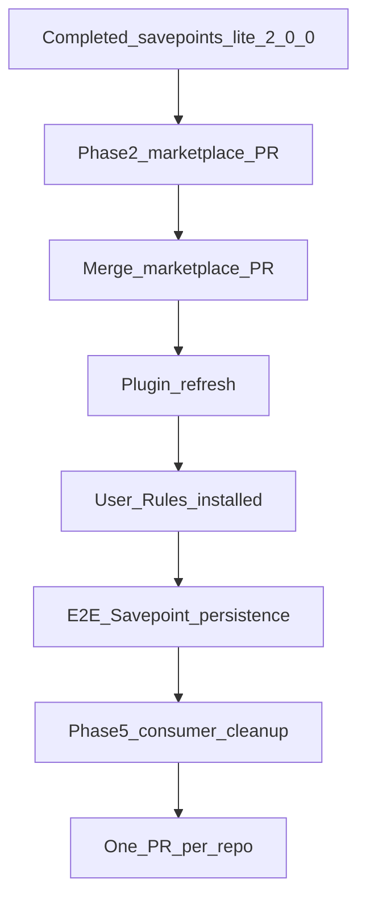

# Centralized Savepoints Lite via Team Marketplace

## Recommended execution authority

| Slice | Recommended authority | Agent instruction |
| --- | --- | --- |
| plan-review | Plan-only PR | Do not implement slices. Stop after opening the plan-only PR. |
| marketplace-distribution | Open PR only | Marketplace repo only. Mark `marketplace-distribution` completed in plan frontmatter in the **same** implementation PR. Stop after opening the PR. |
| gate-consumer-prereqs | Manual verification gate | Read-only verification; pass/fail report with evidence. No commit, no PR, no tracked plan edits. Stop after the report. |
| consumer-cleanup | Open PR only | **Prerequisite:** `gate-consumer-prereqs` **passed** (per gate report evidence). One repo per PR; each PR modifies **only** that repository. Do not edit this marketplace plan. |
| plan-closure | Open PR only | Docs-only archive PR after merge verification (§ plan-closure). Reconcile gate + slice todos; `# Shipped` evidence; archive. Do not merge. |

Repo default: **Open PR only** (plan-review for plan artifact only).

## Repository topology

Multi-slice plans stack execution order, not Git branches. Integration branch is `main` for every repository.

**Before implementation:** `git fetch` and branch from latest `origin/main` in the target repo.

**Before opening the PR:** branch contains only the current slice.

**After opening the PR:** GitHub base is `main`; diff excludes prior-slice work except through merged `main`.

**Cross-repo:** Phases 1–2 → `cursor-team-marketplace`. Consumer cleanup → each consumer repo (separate PRs).

## Plan coordination (cross-repository)

This file lives in **`multipliers-dev/cursor-team-marketplace`** and is the **single coordination record** for the initiative.

| Event | Where to record progress |
| --- | --- |
| Marketplace implementation PR opened/merged | Mark `marketplace-distribution` `completed` and link the merged PR in **the same implementation PR** (frontmatter + optional `# Progress` note in plan body). |
| `gate-consumer-prereqs` | **Not** in tracked files during the gate. Operator/agent keeps a pass/fail report with evidence (chat, operator notes, or allowed gitignored artifacts only). `gate-consumer-prereqs` → `completed` is reconciled in the **`plan-closure`** PR from that evidence. |
| Consumer cleanup | Each consumer repo: its own Open PR only (merge to that repo’s `main` before closure). **Never** edit this marketplace plan from consumer repos. Inventory (repo → merged PR link or “no change”) is recorded in the **`plan-closure`** PR (`# Shipped` + plan body). `consumer-cleanup` → `completed` in frontmatter during **`plan-closure`** only. |
| Initiative complete | `plan-closure` docs-only PR: verify merges and gate evidence (§ plan-closure); reconcile todos; `# Shipped`; archive; mark `plan-closure` completed. |

Implementation PRs in **other** repositories **must not** edit this marketplace plan. No separate `plan-status-*` PRs.

Run `npm run validate:plans` on any commit that changes this plan file.

## Completed prerequisites

Upstream Savepoints Lite work is **done** — not pending marketplace execution:

- **`@multipliers-dev/savepoints-lite@2.0.0`** is published on npm; registry version and `latest` dist-tag verified; clean install produced the expected 16 packaged files.
- **Merged Savepoints Lite PRs [#13](https://github.com/multipliers-dev/savepoints-lite/pull/13)–[#17](https://github.com/multipliers-dev/savepoints-lite/pull/17)** (configuration contract, OSS readiness, post-publish hub dogfood bump).
- **Archived OSS readiness plan:** [`savepoints-lite/.cursor/plans/archive/2026-10-27-oss-readiness-cleanup.plan.md`](https://github.com/multipliers-dev/savepoints-lite/blob/main/.cursor/plans/archive/2026-10-27-oss-readiness-cleanup.plan.md).

The published package owns canonical router/provider behavior, destination precedence (explicit integration → `.agents` → packaged defaults), and fail-open semantics. This marketplace plan **does not** reopen savepoints-lite OSS or publish gates.

## Context and gates



- **Hard gate (consumer cleanup):** Do not start `consumer-cleanup` until `gate-consumer-prereqs` **passes** (documented pass/fail report with evidence — not inferred from plan todo status). Prerequisites: marketplace implementation **merged** to `main`; team-harness plugin installed/refreshed; vendored canonical skills readable in the installed plugin; engineering invariants in global Cursor User Rules; **end-to-end Savepoint persistence** through the installed plugin (not only `node_modules` in a dev checkout).
- **Target semver:** `2.0.0` (breaking: packaged Notion destination removed; explicit-integration tier added).

### Relationship to savepoints-lite OSS work

[PR #13](https://github.com/multipliers-dev/savepoints-lite/pull/13) and follow-on PRs **#14–#17** completed OSS readiness and publish. Do not reopen that work from this plan.

This plan supersedes the archived OSS plan’s **pre-2.0.0 seven-consumer `.agents` migration** with **consumer cleanup after marketplace + User Rules + verified plugin integration**.

### Architectural boundaries (marketplace slice)

| Rule | Detail |
| --- | --- |
| Canonical behavior | Savepoints Lite npm package / vendored `vendor/savepoints-lite/` — router, provider, precedence, fail-open |
| Wrapper scope | `plugins/team-harness/skills/savepoints/SKILL.md` — Cursor discovery, delegation, explicit Notion `data_source_id` from User Rules into instruction context only |
| No duplication | No duplicate event-detection or Notion mapping logic in the marketplace |
| No runtime `node_modules` | Installed Cursor plugin must not depend on `npm install` for skills |
| No upstream edits | Do not modify the published Savepoints Lite package from marketplace work |
| No package-wide default | Do not add a maintainer destination default to the team-harness plugin for all consumers |

---

## Slice — marketplace-distribution

**Recommended authority:** Open PR only

**Repositories:** `multipliers-dev/cursor-team-marketplace` (read/write)

**Prerequisite:** Completed prerequisites (§ above) — `@2.0.0` on npm and verified.

**Rationale:** Cursor installs plugin content from Git without `npm install`; canonical skills must be committed under `vendor/` with sync/verify against the pinned release, plus a thin wrapper and User Rules destination handoff.

**Agent instruction:** Marketplace repo only; do not implement `consumer-cleanup`. Mark `marketplace-distribution` `completed` in this plan’s frontmatter in the **same** PR. Stop after opening the PR.

**Goal:**

- Pin `@multipliers-dev/savepoints-lite@2.0.0` as a root **build-time** `devDependency`.
- Deterministically copy canonical published skills into `plugins/team-harness/vendor/savepoints-lite/` (sync + verify scripts; CI detects vendor drift vs pinned npm release).
- Commit vendored artifacts (plugin install does not run `npm install`).
- Thin discoverable `plugins/team-harness/skills/savepoints/SKILL.md` wrapper: carry explicit Notion destination from global Cursor User Rules (engineering invariants) through vendored router → provider **instruction context**; provider **does not** read User Rules.
- Update [`docs/engineering-invariants.md`](docs/engineering-invariants.md) and relevant integration documentation (personal `data_source_id` only in User Rules, not vendor/canonical package).
- Bump team-harness plugin version to **`1.15.0`**.

**Acceptance:** `verify:savepoints-vendor` (or equivalent script name), `npm test`, `npm run validate:plans`, `scripts/check.sh`; frontmatter `marketplace-distribution` → `completed`; PR opened (Open PR only).

---

## Slice — gate-consumer-prereqs

**Recommended authority:** Manual verification gate

**Rationale:** Consumer cleanup must not run before global integration is live and proven.

**Agent instruction:** Read-only verification only. Produce a **pass/fail report** with supporting evidence (commands run, paths inspected, Notion write outcome, links to merged marketplace PR on GitHub). **Do not** commit, open a PR, or modify tracked plan frontmatter or other tracked files. Allowed outputs: chat report and gitignored operator artifacts if the slice names them. Stop after the report. Reconcile `gate-consumer-prereqs` → `completed` in frontmatter during **`plan-closure`** when evidence proves pass.

**Acceptance (report must evidence each item):**

- Marketplace `marketplace-distribution` implementation PR **merged** to `cursor-team-marketplace` `main` (GitHub merge status / `gh pr view`).
- Team-harness plugin refreshed in Cursor; vendored `vendor/savepoints-lite/skills/` readable under installed plugin cache (path cited in report).
- Engineering invariants Savepoints section present in **global Cursor User Rules** (summary in report).
- End-to-end Savepoint write confirmed via installed plugin path (Notion MCP + wrapper → vendored router/provider; Savepoint URL or id in report).

**Verdict:** `pass` only if all items evidenced; otherwise `fail` — do not start `consumer-cleanup`.

---

## Slice — consumer-cleanup

**Recommended authority:** Open PR only

**Prerequisite:** `gate-consumer-prereqs` **passed** per gate report evidence (not plan todo status alone).

**Repositories (inventory):** `multipliers-dev/savepoints-lite`, `multipliers-dev/cursor-team-marketplace`, `multipliers-dev/editorial-workflow`, `multipliers-dev/renovate-workflow`, `multipliers-dev/codenames-ai-guesser`, `mastermichaelt/resumes`, `mastermichaelt/portfolio` — extend if grep finds more. Final inventory table is recorded in **`plan-closure`**.

**Rationale:** Redundant per-repo npm deps, `.agents` Savepoints config, and `AGENTS.md` activation are obsolete once team-harness + User Rules provide global Savepoints.

**Agent instruction:** One repo per PR; each PR touches **only** that repository. Do not merge. Do not edit `cursor-team-marketplace` plan files or frontmatter. Do not remove savepoints-lite canonical package files or the marketplace root build-time devDependency. Stop after opening required PRs (or documenting no-change repos in operator notes for later `plan-closure`).

**Goal:** Remove redundant consumer `savepoints-lite` npm dependencies, `AGENTS.md` Savepoints Lite activation sections, and obsolete `.agents` Savepoints YAML where appropriate. Repos with no required edits: record “no change” for `plan-closure` (not in this plan file during consumer work).

**Exclusions:** No hooks, monitoring, or reliability improvements.

**Acceptance:** Per-repo verification; PRs opened (Open PR only). Completion is proven by **merged** consumer PRs (or documented no-change) verified again at `plan-closure` — not by opened PRs alone.

---

## Slice — plan-closure

**Recommended authority:** Open PR only

**Rationale:** Archive completed multi-slice plan per repository planning standards.

**Agent instruction:** Docs-only PR in `cursor-team-marketplace` only. **Before** editing the plan to archive: verify prerequisites with GitHub and repository state (`gh pr view`, merged commits on each repo’s `main`). If any check fails, **stop** with a blocker report — do not archive. When all pass: reconcile frontmatter (`marketplace-distribution`, `gate-consumer-prereqs`, `consumer-cleanup`, `plan-closure` → `completed` as applicable), add `# Shipped` with evidence (merged PR links, gate report summary, consumer inventory), move plan to `.cursor/plans/archive/`. Do not merge the closure PR.

**Pre-archive verification (all required):**

1. **Marketplace distribution** — implementation PR **merged** into `multipliers-dev/cursor-team-marketplace` `main` (not open/draft).
2. **Gate** — `gate-consumer-prereqs` **passed**; cite evidence: installed plugin path, User Rules, readable vendored skills, successful E2E Savepoint persistence (from gate report).
3. **Consumer cleanup** — every inventory repo either has a cleanup PR **merged** to that repo’s `main` or is documented **no change**; no required cleanup PR still open.
4. **No open implementation work** — no remaining required slices or unmerged PRs for this initiative.

Do not infer completion from opened PRs or previously pending todos alone.

**Acceptance:** Blocker report if any prerequisite unmet. Otherwise: archive path correct; `# Shipped` includes cross-repo merged PR links + gate + inventory; frontmatter todos reconciled; `npm run validate:plans` passes; closure PR opened (Open PR only).

---

## Phase — Verification (marketplace slice)

| Acceptance criterion | How |
| --- | --- |
| Wrapper discoverable | `scripts/check.sh` includes `skills/savepoints/SKILL.md` |
| Canonical skills readable | `vendor/savepoints-lite/skills/` |
| Wrapper handoff | Destination carried through delegation; provider not told to read User Rules |
| Vendor matches registry | `npm run verify:savepoints-vendor` (or named verify script from slice) |
| Installed plugin | Inspect `~/.cursor/plugins/cache/.../team-harness/<sha>/` after refresh |

---

## Final completion checklist

- [ ] `marketplace-distribution` PR **merged** to marketplace `main`; team-harness **1.15.0**; vendor sync/verify in CI
- [ ] `gate-consumer-prereqs` **pass** report with evidence (no tracked plan edit during gate)
- [ ] Consumer cleanup: required PRs **merged** per repo (or **no change** documented)
- [ ] `plan-closure` verifies merges + gate evidence; reconciles todos; `# Shipped`; archive PR opened

---

## Agent prompts (copy/paste for Cursor)

### plan-review

```text
@.cursor/plans/2026-10-27-savepoints-marketplace-distribution.plan.md

Implement slice plan-review only.

Authority: Plan-only PR — do not implement other slices. Stop after opening the PR.

Topology: branch from latest origin/main in multipliers-dev/cursor-team-marketplace; PR base main.

Deliverables: commit .cursor/plans/2026-10-27-savepoints-marketplace-distribution.plan.md only.

Verification: npm run validate:plans. Mark plan-review completed in frontmatter in the same PR.
```

### marketplace-distribution

```text
@.cursor/plans/2026-10-27-savepoints-marketplace-distribution.plan.md

Implement slice marketplace-distribution only.

Authority: Open PR only — do not merge.

Repositories: multipliers-dev/cursor-team-marketplace only.

Prerequisite: @multipliers-dev/savepoints-lite@2.0.0 published (completed prerequisites). Stop only if registry pin is missing.

Topology: branch from origin/main; PR base main.

Deliverables: root devDependency @2.0.0; vendor sync/verify scripts + committed plugins/team-harness/vendor/savepoints-lite/; thin plugins/team-harness/skills/savepoints/SKILL.md (User Rules destination → router/provider instruction context); docs/engineering-invariants.md + integration docs; team-harness version 1.15.0. Preserve architectural boundaries in plan (no duplicate Notion logic, no runtime node_modules in plugin, no upstream package edits). Do not implement consumer-cleanup.

Verification: npm run verify:savepoints-vendor (or slice script), npm test, npm run validate:plans, sh scripts/check.sh. Mark marketplace-distribution completed in plan frontmatter in this PR.
```

### gate-consumer-prereqs

```text
@.cursor/plans/2026-10-27-savepoints-marketplace-distribution.plan.md

Implement slice gate-consumer-prereqs only.

Authority: Manual verification gate — read-only. No commit, no PR, no tracked plan or repo edits. No consumer repo implementation.

Topology: N/A (operator + filesystem + Notion checks).

Deliverables: pass/fail report with evidence for: marketplace distribution PR merged to main (gh pr view); plugin refreshed; vendored skills readable under ~/.cursor/plugins/cache/.../team-harness; User Rules engineering invariants; end-to-end Savepoint persistence via installed plugin.

Verification: cite commands/paths/URLs in the report. Do not update plan frontmatter. Stop before consumer-cleanup on fail. Todo reconciliation happens in plan-closure when evidence is archived in # Shipped.
```

### consumer-cleanup

```text
@.cursor/plans/2026-10-27-savepoints-marketplace-distribution.plan.md

Implement slice consumer-cleanup only.

Authority: Open PR only — one PR per repo; do not merge.

Prerequisite: gate-consumer-prereqs passed. Stop if not.

Repositories: inventory in plan; prove checkout identity per repo.

Topology: each consumer repo branches from origin/main; PR base main; one slice per PR.

Deliverables: remove redundant savepoints-lite consumer deps, AGENTS.md Savepoints activation, obsolete .agents Savepoints YAML; preserve marketplace build-time devDep and savepoints-lite canonical package/skills. Note no-change repos for plan-closure (operator notes only — not marketplace plan edits).

Verification: per-repo npm test/check as documented. Do not edit cursor-team-marketplace or this plan file from consumer repos.
```

### plan-closure

```text
@.cursor/plans/2026-10-27-savepoints-marketplace-distribution.plan.md

Implement slice plan-closure only.

Authority: Open PR only — docs-only. Do not merge.

Topology: branch from origin/main in cursor-team-marketplace; PR base main.

Deliverables: If prerequisites unmet, blocker report only — do not archive. If met: reconcile frontmatter (marketplace-distribution, gate-consumer-prereqs, consumer-cleanup, plan-closure completed); # Shipped with merged PR links, gate evidence summary, consumer inventory (merged PR or no change per repo); move plan to .cursor/plans/archive/2026-10-27-savepoints-marketplace-distribution.plan.md.

Verification: gh pr view (merged) for marketplace distribution PR and each required consumer cleanup PR; confirm gate pass evidence; confirm no open required PRs. npm run validate:plans. No production code changes.
```
