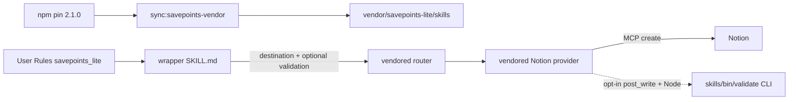

# Shipped

**Date:** 20 Nov 2026

Adopted published `@multipliers-dev/savepoints-lite@2.1.0` into team-harness **1.16.0** (pin, vendor sync including CLI + contracts, thin User Rules → tier-1 `validation.post_write` handoff, vendored CLI smoke, docs). Default instruction-only path unchanged; post-write validation remains opt-in.

### Marketplace PRs

| Slice | PR |
| --- | --- |
| plan-review (plan-only) | [#77](https://github.com/multipliers-dev/cursor-team-marketplace/pull/77) |
| adopt-2.1.0 | [#78](https://github.com/multipliers-dev/cursor-team-marketplace/pull/78) (`MERGED` 2026-11-20; merge commit `6a4449a`) |
| plan-closure | (this PR) |

### `manual-verification` (manual verification gate)

Recorded during the gate slice (chat report; no tracked plan edit during gate). Operator-authorized live Notion MCP against checkout vendor `plugins/team-harness/vendor/savepoints-lite` (`PACKAGE_VERSION=2.1.0`). Automated tests were **not** treated as proof of agent behavior.

| Scenario | Verdict | Evidence |
| --- | --- | --- |
| Default off (verification.md 14) | **pass** | Confirmed create; no CLI. [page](https://app.notion.com/p/41e6cffaff9c8186b4b6f8ad4c2fce1d) |
| Validation enabled + Node (15) | **pass** | Create → read-back → vendored CLI `--stdin` exit 0, `ok: true`. [page](https://app.notion.com/p/41e6cffaff9c81fdb1acf6fb3ba51ea3) |
| Bounded repair (16) | **pass** | Empty `Repository` → `missing_persisted_property` → one repair → re-check `ok: true` (same page). [page](https://app.notion.com/p/41e6cffaff9c8131bb34ce1a5627835a) |
| Node / CLI unavailable (18) | **pass** | Confirmed create; missing CLI → **verification unavailable**; no repair; `success`. [page](https://app.notion.com/p/41e6cffaff9c81b68297f9af76ff6966) |
| Validation disabled | **pass** | Explicit `post_write: false`; instruction-only; no CLI. [page](https://app.notion.com/p/41e6cffaff9c8166a65dff51fed99366) |

**Gate-time host install note:** Cursor plugin cache was still team-harness **1.15.0** / vendor **2.0.0** during the gate, so claims about the *installed* plugin path were **inconclusive** then. Scenarios ran against the merged checkout vendor tree. Upstream rows **17** (irreparable) and **19** (repair confirmation unknown) were **not run** (outside the plan table).

**Closure-time plugin refresh:** Operator cache now includes team-harness **1.16.0** at `~/.cursor/plugins/cache/multipliers-dev-cursor-team-marketplace/team-harness/6a4449ab730ac20d2be07e1e83644f483d8e1a3c/` (CLI present under vendor `skills/bin/`).

### Deferred work

- Optional operator paste of generated User Rules with `validation.post_write: true` (committed invariants keep the flag commented / off by default).
- Upstream verification.md rows **17** and **19** remain unexercised unless a future session re-runs the fuller hub table.
- Agents may still ignore opt-in CLI instructions even when files are present — documented; not mitigated by CLI smoke alone.

# Adopt Savepoints Lite v2.1.0

## Recommended execution authority

| Slice | Recommended authority | Agent instruction |
| --- | --- | --- |
| adopt-2.1.0 | Open PR only | Do not merge. Stop after opening the PR. |
| manual-verification | Manual verification gate | Do not commit or open a PR. Run only the specified verification; report the verdict; stop. |
| plan-closure | Open PR only | Do not merge. Stop after opening the PR. |

Repo default: **Open PR only** (see team skill `/planning-methodology`).

## Repository topology (default)

Multi-slice plans stack execution order, not Git branches. Integration branch is `main`.

**Before implementation:** start from latest `origin/main`.

**Before opening the PR:** branch represents only this slice.

**After opening the PR:** GitHub PR base is `main`.

## Current state and upstream dependency

| Fact | Evidence |
| --- | --- |
| Upstream PR [#20](https://github.com/multipliers-dev/savepoints-lite/pull/20) merged | Optional `validation.post_write`, bundled CLI, `schema.json` / `mapping.json` |
| Workspace `savepoints-lite` version | `2.1.0` on `main` |
| **npm `@multipliers-dev/savepoints-lite@2.1.0` published** | Registry `latest` = `2.1.0`; tarball includes `skills/bin/savepoints-lite-validate.mjs`, `skills/savepoints/schema.json`, `skills/savepoints-notion/mapping.json` (20 packaged files) |
| Marketplace pin today | Root [`package.json`](package.json) + lockfile: **`2.0.0`** |
| Vendor today | [`plugins/team-harness/vendor/savepoints-lite/`](plugins/team-harness/vendor/savepoints-lite/) — 7 skill files + `PACKAGE_VERSION=2.0.0`; **no** `skills/bin/`, `schema.json`, or `mapping.json` |
| Sync model | [`scripts/sync-savepoints-vendor.sh`](scripts/sync-savepoints-vendor.sh) copies **only** `node_modules/.../skills` → vendor (sufficient: validator ships under `skills/`) |
| Wrapper today | [`plugins/team-harness/skills/savepoints/SKILL.md`](plugins/team-harness/skills/savepoints/SKILL.md) — User Rules `savepoints_lite.destination` → tier-1 `destination` only; **no** `validation` handoff |
| Plugin catalog version | team-harness **`1.15.0`** (three-way alignment per [`versioning.md`](plugins/team-harness/docs/versioning.md)) |

**Single-source-of-truth model (preserve):** canonical behavior stays in published Savepoints Lite; marketplace pins exact semver, byte-syncs `skills/`, and keeps a thin wrapper for User Rules → router context. Consumers do **not** install Savepoints Lite.



## Upstream contract verification (tier-1 `validation.post_write`)

Verified against merged Savepoints Lite `@2.1.0` skills (PR [#20](https://github.com/multipliers-dev/savepoints-lite/pull/20) / published package) — **compatible; no marketplace override of packaged defaults is required or implied.**

| Claim | Upstream evidence | Verdict |
| --- | --- | --- |
| Integration may supply tier-1 `validation.post_write` | Router `### validation.post_write` tier 1 = “Labelled `validation` in the **integration instruction/delegation context**”; Integration handoff YAML shows `destination` + `validation` together | Supported |
| Precedence: integration → `.agents` → packaged default | Router three-tier table; absent key falls through; packaged `defaults.yml` has `validation.post_write: false` | Supported |
| Provider consumes router-resolved flag | Notion provider: “use the **resolved** `validation.post_write` flag from the router handoff”; if handoff omits flag, provider falls back to `.agents` then packaged defaults | Supported |
| Wrapper must not invent a parallel precedence | Router/provider **do not** read Cursor User Rules; only the calling integration may map host config into labelled YAML | Marketplace wrapper stays thin — maps User Rules → labelled tier-1 YAML only |
| Package invariants lock the docs contract | `test/package-invariants.test.js` asserts router documents integration-tier `validation.post_write` precedence | Supported |

**Incompatibility check:** none found. If a future upstream release removed integration-tier validation or inverted precedence so a marketplace-supplied `validation.post_write: true` could not beat packaged `false`, adoption would **stop** and document that gap rather than inventing wrapper-side override logic.

**Implication for this plan:** the proposed User Rules → wrapper → tier-1 `validation: { post_write }` handoff is the documented integration channel. Omitting `validation` from the handoff correctly falls through to packaged `false`.

## Design decisions (locked)

1. **Prerequisite satisfied:** do not wait on publish; implement against registry `2.1.0`.
2. **One implementation PR** ships pin + lockfile + vendor sync + expected-path manifest + wrapper + structural verify + **vendored CLI smoke test** + docs + team-harness **`1.16.0`** (minor: optional capability).
3. **Opt-in via existing User Rules namespace** (not consumer `.agents/savepoints-lite.yml`), because upstream already accepts the same labelled block as destination:

```yaml
savepoints_lite:
  destination:
    data_source_id: "<id>"
  # Optional — omit for packaged default (false)
  validation:
    post_write: true
```

Wrapper maps (instruction context only — does not override packaged defaults by other means):
- `savepoints_lite.destination` → tier-1 `destination` (unchanged rules)
- when `savepoints_lite.validation.post_write` is an explicit boolean → tier-1 `validation: { post_write: <bool> }` (upstream tier 1)
- when `validation` is absent → **omit** tier-1 `validation` so router/provider fall through to packaged default `false`

4. **Do not** always inject `post_write: false` from the wrapper (avoid claiming tier-1 when the operator never configured validation).
5. **No** sync script redesign beyond expected-path list + executable/shebang checks — `cp -R skills` already copies `skills/bin/`.
6. **Bundling ≠ agent invocation:** docs and acceptance must state that automated vendor/layout/CLI smoke tests prove file presence, install-root contract loading, and deterministic CLI exits — not that agents run the CLI during Notion persistence.
7. **Do not** edit `multipliers-dev/savepoints-lite` from this plan.

## Out of scope

- Publishing or modifying Savepoints Lite
- Separate validator npm package, custom MCP server, background reconciliation
- Mandatory Node.js for ordinary Savepoint creation
- Requiring `.agents/savepoints-lite.yml` in consumer repos
- Backfill of historical incomplete Notion rows
- Consumer-repo activation/cleanup (already completed under prior distribution plan)
- Enabling `validation.post_write: true` in committed engineering invariants by default

---

## Slice — adopt-2.1.0

**Recommended authority:** Open PR only

**Rationale:** Single coherent marketplace adoption; merge-safe when vendor verify + layout + tests pass; default behavior unchanged.

**Agent instruction:** Do not merge. Stop after opening the PR.

**Required repositories:** `multipliers-dev/cursor-team-marketplace` only (sync from published npm; no savepoints-lite checkout required).

**Goal:** Ship team-harness distribution of Savepoints Lite **2.1.0** with optional post-write validation assets and thin User Rules handoff for `validation.post_write`, default off.

**Acceptance:** Pin/lockfile `@2.1.0`; vendor skills byte-match npm (including CLI, `schema.json`, `mapping.json`); shebang/executable asserts; post-sync upstream tier-1 `validation.post_write` contract still documented; thin wrapper User Rules → tier-1 validation handoff (omit → packaged false); vendored CLI Vitest smoke (valid → exit 0; missing required → exit 1 + `missing_persisted_property`); docs + team-harness `1.16.0` aligned; `npm run verify:savepoints-vendor`, layout verify, `npm test`, `npm run typecheck`, `npm run validate:plans`, `scripts/check.sh`; frontmatter `adopt-2.1.0` → `completed`; PR opened (Open PR only).

### Implementation steps (dependency order)

1. **Pin:** set root `devDependencies["@multipliers-dev/savepoints-lite"]` to exact `"2.1.0"`; update lockfile via `npm install` / `npm ci` path that refreshes the package.
2. **Expected paths:** extend [`scripts/expected-savepoints-vendor-paths.txt`](scripts/expected-savepoints-vendor-paths.txt) with at least:
   - `skills/bin/savepoints-lite-validate.mjs`
   - `skills/savepoints/schema.json`
   - `skills/savepoints-notion/mapping.json`
3. **Sync:** `npm run sync:savepoints-vendor` → commit updated `plugins/team-harness/vendor/savepoints-lite/` (full skills tree + `PACKAGE_VERSION=2.1.0`).
4. **Verify hardening:** in [`scripts/verify-savepoints-vendor.sh`](scripts/verify-savepoints-vendor.sh) (and sync if useful), assert the CLI file is present, has a Node shebang (`#!/usr/bin/env node`), and is executable (`-x`) under vendor after sync.
5. **Wrapper** ([`plugins/team-harness/skills/savepoints/SKILL.md`](plugins/team-harness/skills/savepoints/SKILL.md)):
   - Extend package-equivalent install root table to include `skills/bin/savepoints-lite-validate.mjs` (and that `schema.json` / `mapping.json` resolve under the vendor install root).
   - Document tier-1 `validation` handoff from User Rules (mapping rules above), citing that upstream router precedence already supports this channel (see **Upstream contract verification**).
   - Keep wrapper thin: no validation logic, no MCP sequences, no duplicate property mapping, no alternate precedence that bypasses packaged defaults.
6. **Layout / check gates:**
   - Update [`scripts/verify-savepoints-marketplace-layout.sh`](scripts/verify-savepoints-marketplace-layout.sh) (+ Vitest fixtures in [`scripts/verify-savepoints-marketplace-layout.test.ts`](scripts/verify-savepoints-marketplace-layout.test.ts)) for new wrapper contract greps / resolvable vendor paths including the CLI.
   - Optionally extend [`scripts/check.sh`](scripts/check.sh) structural presence checks for vendored `schema.json` + CLI (works without `npm ci`).
7. **Vendored CLI smoke test (deterministic, required in this PR):**
   - Add a Vitest file under `scripts/` (e.g. `scripts/verify-savepoints-vendor-cli.test.ts`) that uses the **committed** marketplace layout as the install root:
     - `VENDOR_ROOT = plugins/team-harness/vendor/savepoints-lite`
     - CLI = `$VENDOR_ROOT/skills/bin/savepoints-lite-validate.mjs`
   - Invoke with `node` + the vendored CLI (prefer discovery from the CLI path with **no** `--package-root`, proving walk-up finds `skills/savepoints/schema.json` and `skills/savepoints-notion/mapping.json` under the vendor tree; optionally also assert `--package-root "$VENDOR_ROOT"`).
   - **Valid record:** stdin/`--input` with required Notion properties present (`Name`, `Repository`, `Agent`) → exit `0`, JSON `ok: true`.
   - **Missing required property:** same shape with a required mapped property empty/absent (e.g. empty `Repository`) → exit `1`, JSON includes `missing_persisted_property` for that field.
   - Do **not** spawn against `node_modules/@multipliers-dev/savepoints-lite` as the primary install root for this test — the point is the vendored plugin layout.
   - This proves deterministic CLI + contract loading only; it does **not** prove agent invocation.
8. **Docs (minimum):**
   - [`plugins/team-harness/docs/savepoints-integration.md`](plugins/team-harness/docs/savepoints-integration.md) — pin `@2.1.0`, optional validation User Rules, fail-open / Node optional, Plan Validator vs bundled Savepoints validator distinction (mirror upstream architecture table), note that tier-1 validation handoff is an upstream router contract.
   - [`docs/engineering-invariants.md`](docs/engineering-invariants.md) — document optional `validation.post_write` under Destination as **commented opt-in**; keep destination placeholder behavior; do **not** enable validation by default.
   - [`docs/engineering-invariants.local.example.yml`](docs/engineering-invariants.local.example.yml) — optional commented `validation` block (generator remains destination-id-only).
   - [`plugins/team-harness/docs/versioning.md`](plugins/team-harness/docs/versioning.md) current version table → `1.16.0`.
9. **Plugin version bump to `1.16.0`:** align [`plugins/team-harness/plugin.json`](plugins/team-harness/plugin.json), [`plugins/team-harness/.cursor-plugin/plugin.json`](plugins/team-harness/.cursor-plugin/plugin.json), [`.cursor-plugin/marketplace.json`](.cursor-plugin/marketplace.json) `metadata.version`.

### Files likely to change

- `package.json`, `package-lock.json`
- `scripts/expected-savepoints-vendor-paths.txt`
- `scripts/sync-savepoints-vendor.sh` and/or `scripts/verify-savepoints-vendor.sh` (executable/shebang asserts)
- `scripts/verify-savepoints-marketplace-layout.sh`, `scripts/verify-savepoints-marketplace-layout.test.ts`
- `scripts/verify-savepoints-vendor-cli.test.ts` (**new** vendored CLI smoke)
- `scripts/check.sh` (optional structural asserts)
- `plugins/team-harness/vendor/savepoints-lite/**` (full resync)
- `plugins/team-harness/skills/savepoints/SKILL.md`
- `plugins/team-harness/docs/savepoints-integration.md`, `plugins/team-harness/docs/versioning.md`
- `docs/engineering-invariants.md`, `docs/engineering-invariants.local.example.yml`
- `plugins/team-harness/plugin.json`, `plugins/team-harness/.cursor-plugin/plugin.json`, `.cursor-plugin/marketplace.json`
- This plan frontmatter todo status

### Acceptance criteria (detail)

- Pin and lockfile resolve `@multipliers-dev/savepoints-lite@2.1.0`.
- `PACKAGE_VERSION` and vendor skills inventory byte-match the pinned npm package `skills/` tree.
- Expected-path manifest includes CLI + `schema.json` + `mapping.json`; verify fails if any are missing.
- Vendored CLI is executable and shebang-correct relative to the vendor install root.
- **Upstream handoff:** vendored router/provider skills (post-sync) still document integration-tier `validation.post_write` as highest precedence over `.agents` and packaged `false`; wrapper handoff uses that channel only. If sync reveals the contract is missing or inverted, stop and escalate — do not invent a marketplace override of packaged defaults.
- Wrapper documents install-root CLI path and optional User Rules → tier-1 `validation` handoff; destination mapping unchanged.
- Default path: no User Rules `validation` key → omit tier-1 `validation` → packaged `validation.post_write: false` (instruction-only).
- Explicit User Rules `validation.post_write: true|false` is passed as labelled tier-1 YAML without requiring consumer `.agents` files.
- **Vendored CLI smoke:** Vitest against `plugins/team-harness/vendor/savepoints-lite` loads schema/mapping from that tree; valid record exits 0; missing required property exits 1 with `missing_persisted_property`.
- team-harness versions aligned at `1.16.0`.
- Docs state Plan Validator (standalone CI package) vs Savepoints Lite validator (bundled; no independent CI consumer); bundling does not guarantee agent invocation.
- No Savepoints Lite repo changes; no separate validator package; no mandatory Node for create/confirm.

### Automated verification (this PR)

```bash
npm ci
npm run sync:savepoints-vendor   # if pin changed; commit result
npm run verify:savepoints-vendor
sh scripts/verify-savepoints-marketplace-layout.sh
npm test                         # includes vendored CLI smoke (valid + missing property)
npm run typecheck
npm run validate:plans
sh scripts/check.sh
```

CI already runs vendor verify after `npm ci` and layout via `check.sh` ([`.github/workflows/ci.yml`](.github/workflows/ci.yml)); `npm test` must cover the new vendored CLI smoke.

**Automated tests do not prove** agent MCP writes, repair behavior, or that agents invoke the CLI during persistence.

---

## Slice — manual-verification

**Recommended authority:** Manual verification gate

**Rationale:** Agent/MCP behavior is instruction-driven; only live sessions prove create, validate, repair, and unavailable-verification paths.

**Agent instruction:** Do not commit or open a PR. Run only the specified verification; write only allowed gitignored outputs if needed; report the verdict; stop.

**Specified verification:** After `adopt-2.1.0` is merged and the operator has refreshed the team-harness plugin to `1.16.0`, run the marketplace-relevant scenarios from vendored [`skills/savepoints/verification.md`](plugins/team-harness/vendor/savepoints-lite/skills/savepoints/verification.md) (upstream rows 14–19), with explicit operator authorization for that session:

| Scenario | Config | Expected |
| --- | --- | --- |
| Default off | No User Rules `validation` | Confirmed create; no mandatory CLI |
| Validation enabled + Node present | `validation.post_write: true` | Read-back + CLI; `ok` or bounded repair; outcome `success` for confirmed create |
| Bounded repair | Induced missing mapped property | One repair attempt; report; `success` if create confirmed |
| Node / CLI unavailable | Validation enabled; Node missing or CLI unusable | **verification unavailable**; confirmed create remains `success` |
| Validation disabled | Explicit `false` or omitted | Instruction-only path |

**Allowed gitignored outputs:** optional notes under a gitignored operator path (e.g. `.agent-runs/` if already used locally); do not commit.

**Verdict:** pass / fail / inconclusive per scenario; stop.

---

## Plan closure (docs-only PR)

**Recommended authority:** Open PR only

**Rationale:** Archive after implementation merge + record manual-verification verdict.

**Agent instruction:** Do not merge. Stop after opening the PR.

After `adopt-2.1.0` merges and `manual-verification` has a recorded verdict:

1. Verify implementation todo completed and PR actually merged to `main`
2. Record manual-verification verdict in `# Shipped`
3. Move plan to `.cursor/plans/archive/2026-11-20-savepoints-lite-2.1.0-adoption.plan.md`
4. Mark `plan-closure` completed

---

## Risks, assumptions, unresolved

**Assumptions**

- Registry `@2.1.0` tarball remains the sync source of truth (already verified locally).
- Upstream router/provider continue to document integration-tier `validation.post_write` as in published `@2.1.0` (verified before planning; re-check after vendor sync in the implementation PR).
- `cp -R` preserves executable bit in this maintainer environment; shebang/executable asserts catch regressions.
- Operators must refresh the Cursor plugin after `1.16.0` for cache layout checks and live skills.

**Risks**

- Agents may ignore opt-in CLI instructions even when files are present — documented; manual gate only; CLI smoke does not mitigate this.
- Future upstream skill edits could weaken or remove tier-1 validation handoff — acceptance requires post-sync prose check; stop rather than invent marketplace override.
- Operators with stale User Rules paste miss the optional validation docs until they regenerate/repaste.
- Layout verify against plugin cache only runs when cache version matches repo plugin version.

**Unresolved decisions:** none material for implementation (publish gate closed; opt-in channel locked to User Rules; upstream handoff verified compatible).

## Agent prompts (copy/paste for Cursor)

### adopt-2.1.0

```text
@.cursor/plans/archive/2026-11-20-savepoints-lite-2.1.0-adoption.plan.md

Implement slice adopt-2.1.0 only. Do not start manual-verification or plan-closure. Do not archive the plan. Do not modify multipliers-dev/savepoints-lite.

Authority: Open PR only — implement and open the PR; do not merge.

Topology: start from latest origin/main; branch represents only this slice; PR base must be main.

Deliverables: pin @multipliers-dev/savepoints-lite@2.1.0 + lockfile; extend expected-savepoints-vendor-paths.txt; sync vendor skills (including skills/bin CLI, schema.json, mapping.json); vendor verify shebang/executable asserts; post-sync confirm vendored router/provider still document integration-tier validation.post_write precedence; thin wrapper User Rules → tier-1 validation handoff only (default omit → packaged false; no marketplace override of defaults); Vitest smoke against plugins/team-harness/vendor/savepoints-lite CLI loading vendor schema.json/mapping.json (valid → exit 0; missing required → exit 1 + missing_persisted_property); layout/check updates; engineering-invariants + savepoints-integration docs (Plan Validator vs bundled validator); team-harness 1.16.0 three-way version bump. Mark adopt-2.1.0 completed in plan frontmatter in this PR.

Verification: npm ci; npm run verify:savepoints-vendor; sh scripts/verify-savepoints-marketplace-layout.sh; npm test (must include vendored CLI smoke); npm run typecheck; npm run validate:plans; sh scripts/check.sh.
```

### manual-verification

```text
@.cursor/plans/archive/2026-11-20-savepoints-lite-2.1.0-adoption.plan.md

Execute only slice manual-verification. Prerequisite: adopt-2.1.0 merged and team-harness plugin refreshed to 1.16.0.

Authority: Manual verification gate — do not commit or open a PR; do not perform implementation work; write only allowed gitignored outputs if needed; report the verdict; stop.

Topology: n/a (no PR).

Deliverables: run vendored verification.md scenarios for default-off, enabled+Node, bounded repair, Node/CLI unavailable, and validation disabled; report pass/fail/inconclusive per scenario.

Verification: operator-authorized live Notion MCP session only; do not claim automated tests prove agent behavior.
```

### plan-closure

```text
@.cursor/plans/archive/2026-11-20-savepoints-lite-2.1.0-adoption.plan.md

Execute only plan-closure.

Authority: Open PR only — docs-only archive PR; do not merge.

Prerequisites: adopt-2.1.0 PR actually merged to main; manual-verification verdict recorded.

Topology: start from latest origin/main; branch represents only this slice; PR base must be main.

Deliverables: add # Shipped (date, PR link, manual verdict, deferred work); move plan to .cursor/plans/archive/2026-11-20-savepoints-lite-2.1.0-adoption.plan.md; mark plan-closure completed; update references. No production behavior changes.

Verification: gh pr view (merged) for adopt-2.1.0; npm run validate:plans.
```
